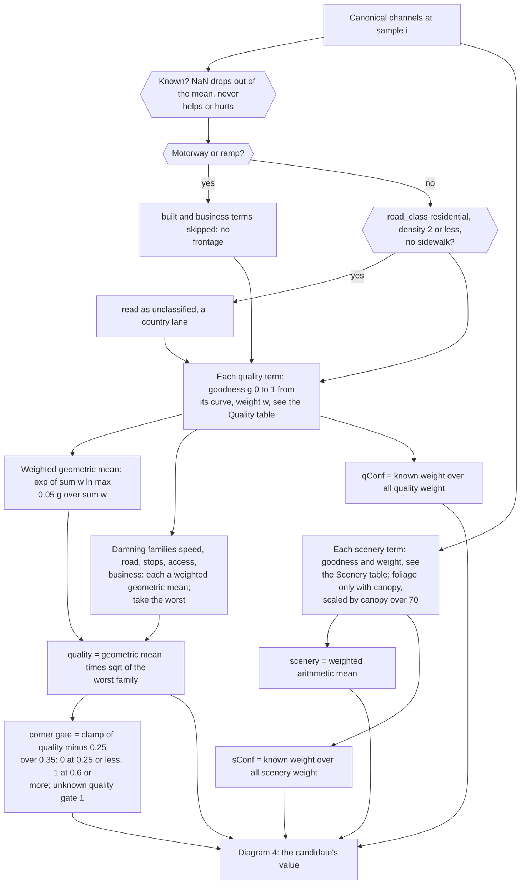
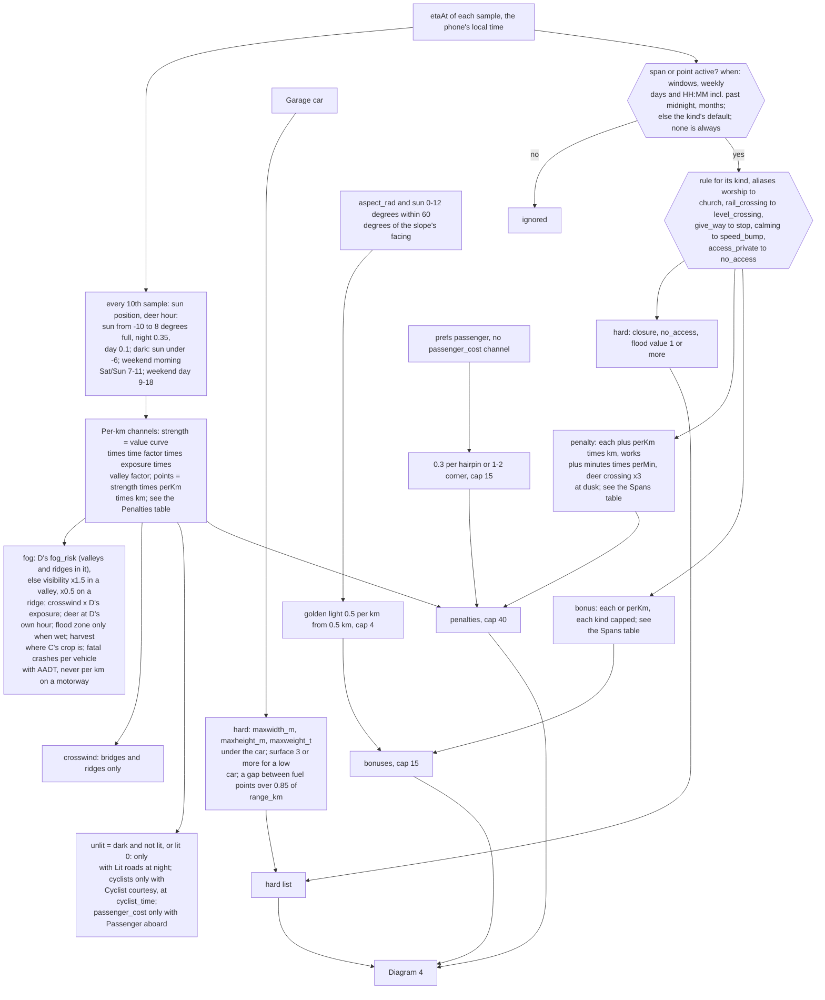
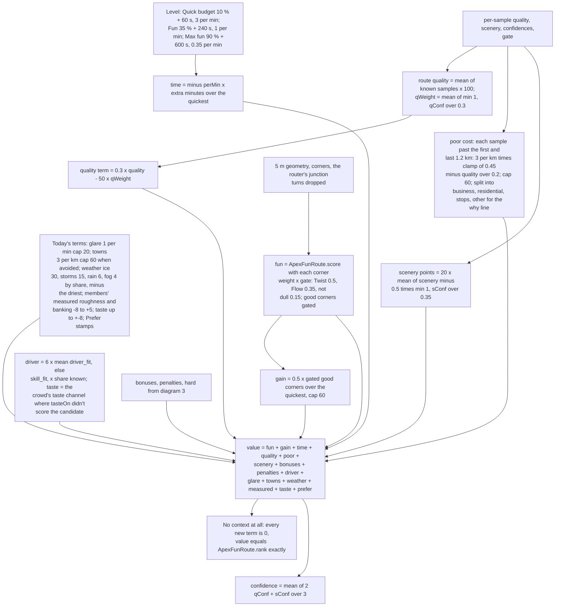

# The route engine

How Vetta decides which way is worth driving: `web/route_engine.js` (the model and the plan search's pieces),
`web/route_ctx/registry.js` (the route context: corridors, providers, one budget), and the providers in
`web/route_ctx/<name>.js`. This page is the reference for anyone adding a data source: the channel names, units and how
each one enters the model are below. docs/ROUTING.md says how the planner uses it; docs/ROAD_INTELLIGENCE.md §7 why.

## Why a model and not a curvature score

Kurviger and Calimoto rank by curvature with road-class switches ("avoid highways", "curvy level"); REVER by community
roads; the scenic and pleasant routing papers (Quercia et al.'s *Shortest path to happiness*, crowd-photo scenic routing,
road-network attractiveness learned from trajectories) by one attractiveness number per edge under a time budget. All of
them fold "is this road worth driving" and "is it twisty" into one score, which is exactly how a curvy subdivision wins:
five good corners in 1.3 km of Menominee Drive beat Pippin Road (the owner's bad case, now a test). The owner: "You can
build a curvy route with just road data but a good route takes road intelligence."

So every 25 m of a candidate gets two separate scores, and the corners only count where the road deserves them:

- **quality** (0–1): is this a road worth driving at all? Speed limit, class and use, density, signals, stops and
  crossings, driveways and side roads, traffic calming, businesses, land use, buildings, night lights, impervious ground,
  addresses, housing, noise, traffic volume, surface, crowd roughness and flow.
- **scenery** (0–1): what it's like: forest and canopy, water and creeks, ridges and relief, open country, parks, photos,
  autumn colour, old roads, loved roads, guardrails and curve signs, banking.

## Flowchart

How data becomes a ranking, as built (2026-11-04). Five linked diagrams: (1) sources and the context run, (2) per-25 m
quality and scenery, (3) penalties, bonuses and hard constraints, (4) a candidate's value, (5) candidates, ranking and the
why line. The weights in them are the code's; the tables in "Weights (checked against the code)" below are read back
from `web/route_engine.js`, `web/fun_route.js` and the providers by tests/test_route_engine_doc.py. Providers marked
All five builders' providers are merged and drawn with their real channel names; what isn't built is named in its box
(snowplough positions, city event permits, live FEMA flood zones, NC and VA work zones, FCC mobile coverage).
A rendered copy for a phone: docs/design/route_engine_flow.html (`python3 tools/route_engine_flow.py` rebuilds it from
this page).

### 1. Sources, fetching and the context run

```mermaid
flowchart TD
  P["Plan: A to B, loop or Explore"] --> CAND["Candidates, see diagram 5"]
  CAND --> COR["Corridor per candidate: samples every 25 m,<br>heading, bbox, etaAt from the router's<br>maneuver clock, else its total time by<br>distance, else 50 km/h; times the live pace<br>0.6 to 1.8 while driving; the Garage car"]
  COR --> RUN["ApexRouteCtx.run: every provider at once on<br>all corridors of the plan; one budget, 4 s<br>for candidates, 1.2 s for stages; each<br>provider gets min of its budgetMs and what<br>is left, and an AbortSignal at the deadline"]
  RUN --> PH["Two phases: D's conditions, wildlife,<br>hazards-live and events, and E's car, start<br>when the rest has landed or at half the<br>budget, with their land use, terrain,<br>density, coverage and schools as<br>opts.channels, peer, places"]
  RUN --> A1["A router_edges.js, priority 10, 2.4 s,<br>stages too: one Valhalla trace_attributes<br>per candidate, edge_walk then map_snap on<br>2000 points, 2 at a time, kept 30 min per<br>line. speed_limit_kph, speed_limit_est_kph<br>flagged, speed_kph, road_class, road_use,<br>density, lanes, surface, sidewalk,<br>truck_route, bridge, tunnel, toll, ramp,<br>roundabout, signals_per_km, access_per_km,<br>intersections_per_km; points signal,<br>junction, driveway"]
  RUN --> A2["A dem.js, priority 20, 2 s, stages too: z12<br>Terrarium tiles, at most 64 a plan, shortest<br>corridors first. elev_m, grade_pct,<br>relief_m, tpi_m, aspect_rad, west_descent;<br>spans climb, descent"]
  RUN --> B1["B osm_tiles.js, 8 s:<br>lu_residential, lu_commercial, lu_retail,<br>lu_industrial, lu_forest, lu_farmland,<br>lu_open, lu_park, lu_mapped, water_near,<br>creek_follow, bldg_per_km, addr_per_km,<br>biz_per_km, junctions_per_km,<br>driveways_per_km, access_per_km, road_class<br>in map codes, on_bridge, in_tunnel, unpaved;<br>points school, worship, viewpoint, place,<br>rail_crossing, gate"]
  RUN --> B2["B osm_overpass.js, 15 s:<br>maxspeed_kph, lanes, divided, oneway,<br>surface_paved, smoothness, hgv,<br>access_level, guard_rail, cycle_route,<br>byway,<br>signals/stops/crossings/calming_per_km,<br>side_roads_per_km, driveway_joins_per_km;<br>points signal, stop, give_way, crossing,<br>calming, level_crossing, curve_sign,<br>animal_crossing, buggy, viewpoint, historic,<br>fuel; spans roundabout, one_lane_bridge,<br>covered_bridge, access_private,<br>access_destination, cycle_route, byway"]
  RUN --> B3["B road_name_age.js: name_age"]
  RUN --> C1["C context_grid.js, 4 s, local bundles<br>web/data/ctx/v1 then the Worker's KV:<br>night_lights, impervious_pct, canopy_pct,<br>noise_db, housing_density,<br>population_density, address_density,<br>median_year_built, flood_zone,<br>cropland_class, park_visits, aadt, iri,<br>hpms_speed_limit, hpms_lanes, hpms_fclass,<br>crash_density; mobile_coverage not built<br>(always unknown); spans nps_unit; points<br>fatal_crash"]
  RUN --> D1["D, second phase with the first's land use<br>and terrain: conditions.js air_temp_c,<br>road_temp_c, visibility_m, fog_risk,<br>crosswind_mps, exposure, precip_6h/48h_mm,<br>wx_hazard, light, glare, golden_view;<br>wildlife.js deer_time_risk, deer_risk;<br>events.js event_crowd, school_zone,<br>school_bus_hour, church_window;<br>hazards_live.js flood_risk, works,<br>harvest_traffic, park_busy, foliage, spans<br>closure, works, flood, low-water, paving;<br>photos.js photo_score, sign_maxspeed_mps,<br>curve_sign. Not built: snowplough (no OHGO<br>endpoint), city permits, FEMA flood zones live,<br>NC and VA work zones"]
  RUN --> E1["E crowd.js, 9 s: crowd_rough_g, crowd_bank_deg,<br>crowd_curv, crowd_conf, crowd_flow, loved,<br>taste, crowd_busy (quiet_hours flag, off);<br>needs lookup /api/roads, crewLines, myTracks"]
  RUN --> E2["E driver.js, 8 s: passenger_cost, tech_level,<br>skill_fit, dark, lit, cyclist_route,<br>cyclist_time, tunnel, driver_fit; spans<br>hairpins, abrupt, unlit_dark, cycle_route,<br>tunnel; For this drive prefs passenger,<br>lit, cyclists, tunnels"]
  RUN --> E3["E car.js, 8 s: fuel_since_km, fuel_margin,<br>signal; spans fuel_gap hard, fuel_check,<br>no_signal; points fuel_stop, share_eta,<br>ask_range; needs apiGet /api/chargers"]
  RUN --> E4["E ios_context.js: free_min; span<br>past_next_event; point album_ends.<br>crew_meet.js: point crew_start"]
  A1 ~~~ A2 ~~~ B1 ~~~ B2 ~~~ B3 ~~~ C1 ~~~ D1 ~~~ E1 ~~~ E2 ~~~ E3 ~~~ E4
  A1 & A2 & B1 & B2 & B3 & C1 & D1 & E1 & E2 & E3 & E4 --> CLEAN["clean: wrong-length channels dropped, NaN is<br>unknown never 0; osm_tiles road_class<br>translated to router codes"]
  CLEAN --> MERGE["merge per channel per sample: lower priority<br>provider wins where it knows, the next fills<br>its gaps; spans and points pooled with their<br>source"]
  STAT ~~~ CANON
  MERGE --> STAT["status per provider: ok, partial,<br>unavailable, no-key, out of time; onUpdate<br>as each lands"]
  MERGE --> CANON["channel: canonical name, gaps filled from<br>aliases and other providers' names, e.g.<br>maxspeed_kph to speed_limit_kph, biz_per_km<br>to business_per_km, lu shares where<br>lu_mapped at least 0.3"]
  CANON --> S2["Diagram 2: per sample"]
  CANON --> CHAIN["speed limit chain: router, OSM maxspeed,<br>Mapillary signs, HPMS (all measured), then<br>the class estimate; HPMS lanes and class<br>fill gaps; D's visibility, crosswind, light<br>and park_busy and C's housing, year built,<br>park visits under the model's names"]
  CHOSEN["route chosen"] --> AFTER["car.js aftercare: ask_range asks once for<br>the car's range; no_signal stretches offer<br>to save their maps (offlineAreas,<br>prepareOffline), then share_eta offers<br>Share ETA"]
```

### 2. Per 25 m: quality, scenery, confidence

### 3. Time, penalties, bonuses, hard constraints

### 4. A candidate's value

### 5. Candidates, ranking, the why line

```mermaid
flowchart TD
  WT["Where to?"] --> DEF["Valhalla, the app's costing use_highways<br>0.15, tolls 0.3, avoid chips, the car's<br>width and clearance; 2 alternates"]
  WT --> HWY["Highway-friendly quickest use_highways 1.0,<br>unless Avoid Highways; trips of 2 km or more"]
  DEF -. "Valhalla down" .-> OSRM["OSRM fallback"]
  WT --> STG["Stages from the map tiles around the<br>corridor, sections on long trips"]
  STG --> NET["Network step: top 8 stages, 12 for Explore,<br>get router edges and DEM in 1.2 s; score x<br>0.4 + 0.6 x mean gate x 1 + 0.4 x scenery -<br>0.5 x known share"]
  NET --> SL["shortlist in the level's ellipse, direction<br>by climb, set list"]
  SL --> MX["connector matrix with use_highways 0.6,<br>avoid kept"]
  MX --> PL["plans of 1-2 stages within the level's<br>budget, routed through shaping points with<br>use_highways 0.6; dropped if under 70 % of a<br>stage is driven"]
  DEF ~~~ HWY ~~~ STG
  DEF & HWY & OSRM & PL --> POOL["pool: keep avoided roads out when any<br>candidate can"]
  POOL --> EARLY{{"over 1.5 s?"}}
  EARLY -- yes --> SHOW["the quickest goes up at once, replaced when<br>the ranking is ready unless driven or<br>replaced"]
  SHOW ~~~ CTXR
  POOL --> CTXR["context run, diagram 1, alongside the towns<br>lookup"]
  CTXR --> TOP["engine ranking picks the contenders for<br>weather (top 4), taste (top 4), members'<br>measurements (top 3), Prefer (top 4)"]
  TOP --> RANK["rank: value per candidate; drop past the<br>level's budget; drop any with a hard<br>constraint unless all have one"]
  RANK --> OPT["up to 3 options, not within 30 s and 1<br>gated-fun point of one kept, none slower and<br>less fun"]
  OPT --> PIN["winner: an alternate or highway-costed route<br>is pinned with shaping points every 5-6 km<br>so a reroute keeps to it"]
  OPT ~~~ WHY
  PIN ~~~ LOOP ~~~ EXP
  RANK --> WHY["why line: the 2-3 parts that differ most<br>from the quickest: side streets or strip<br>malls avoided, highway instead of, good<br>corners, back roads at 45-55 mph, signals,<br>through forest, along the water, ridges,<br>deer hour, less in towns, drier, less low<br>sun; else the old roads and corners line"]
  LOOP["Loops: stage plans and a circle, routed;<br>same context run; value = loopValue on gated<br>fun - 2 per % retraced - 0.8 per % off<br>length + quality + scenery + bonuses - poor<br>- penalties - glare - towns + measured +<br>Prefer; a hard constraint -1000"] --> RANK2["best loop"]
  EXP["Explore: stages within reach, network step,<br>matrix times; listed best first"]
```

## Weights (checked against the code)

tests/test_route_engine_doc.py reads these from the code and fails if a row here drifts. The Quality and Scenery tables
under "The channels" are checked the same way (channel and weight).

| constant | value | meaning |
|---|---|---|
| QUALITY | 0.3 | points per quality point above or below 50, times qWeight |
| POOR_Q_HI | 0.45 | quality where the side-street cost starts |
| POOR_Q_LO | 0.25 | quality where it is full |
| POOR_PER_KM | 3 | points per km at full |
| POOR_CAP | 60 | the most it costs |
| END_GRACE_M | 1200 | metres free at each end |
| SCENERY | 20 | points for scenery 1 vs 0.5, times how much is known |
| Q_FULL_CONF | 0.3 | share of quality weight known for full weight |
| S_FULL_CONF | 0.35 | share of scenery weight known for full weight |
| GATE_LO | 0.25 | quality at which a corner counts nothing |
| GATE_HI | 0.6 | quality at which a corner counts in full |
| PENALTY_CAP | 40 | the most penalties cost |
| BONUS_CAP | 15 | the most bonuses add |
| LOG_FLOOR | 0.05 | the lowest goodness in the geometric mean |
| DRIVER | 6 | points for driver_fit (else skill_fit) 1 vs 0, times the share known |

| per-km penalty | points per km |
|---|---|
| deer_risk | 1.5 |
| fog_vis_m | 1.2 |
| crosswind_ms | 0.6 |
| road_temp_c | 0.25 |
| crash_rate | 0.6 |
| cyclist_route | 0.5 |
| buggy | 0.8 |
| unlit | 0.6 |
| snow_cover | 2 |
| crowd_busy | 0.6 |
| park_visitors | 0.5 |
| signal_coverage | 0.15 |
| fog_risk | 1.2 |
| crash_density | 0.6 |
| event_crowd | 2 |
| school_zone | 3 |
| school_bus_hour | 0.3 |
| church_window | 1 |
| harvest_traffic | 0.5 |
| flood_zone | 2 |
| ice | 3 |
| passenger_cost | 1.5 |
| fuel_margin | 0.5 |

| span or point | each | per km | bonus | bonus per km | cap | hard |
|---|---|---|---|---|---|---|
| closure | | | | | | yes |
| no_access | | | | | | yes |
| flood | 5 | | | | | value 1 or more |
| school | 2 | 1 | | | | |
| church | 1 | | | | | |
| event | 6 | | | | | |
| works | 4 | | | | | |
| harvest | | 0.5 | | | | |
| unploughed | | 2 | | | | |
| byway | | | | 0.4 | 12 | |
| level_crossing | 0.7 | | | | | |
| one_lane_bridge | 0.5 | | | | | |
| animal_crossing | 0.3 | | | | | |
| speed_bump | 0.5 | | | | | |
| stop | 0.4 | | | | | |
| viewpoint | | | 1.5 | | 6 | |
| covered_bridge | | | 2 | | 4 | |
| historic | | | 0.5 | | 3 | |
| waterfall | | | 1 | | 3 | |
| tunnel | | | 1.5 | | 4.5 | |
| resurfaced | | | | 0.3 | 3 | |
| camera | | | | | | |
| gate | 1 | | | | | |
| buggy | 0.5 | | | | | |
| curve_sign | | | 0.2 | | 2 | |
| access_destination | 1 | 2 | | | | |
| cycle_route | | 0.5 | | | | |
| fuel_gap | | | | | | yes |
| past_next_event | 0 | | | | | |

| level | budget | slack s | points per extra minute |
|---|---|---|---|
| quick | 0.1 | 60 | 3 |
| fun | 0.35 | 240 | 1 |
| max | 0.9 | 600 | 0.35 |

## The model

### Per sample

`samples(corridor, ctx)`:

- **Quality** is a weighted *geometric* mean of every known quality term's goodness (each term maps its value to 0 worst
  … 1 best), times the square root of the worst of the *damning* families (speed, road, stops, access, business). The
  geometric mean means a 0.1 is not averaged away by five 1.0s; the soft minimum means plenty of absent signals can't make
  a 25 mph side street, a driveway every 30 m or a row of shops a good road. Values on real roads (Cincinnati fixtures):
  country back roads 0.6–0.85, interstates 0.65–0.75, suburban collectors 0.3–0.45, subdivisions 0.1–0.25, strip-mall
  arterials 0.05–0.25.
- A motorway or ramp has no frontage: the built and business terms (shops, houses, lights beside it) are skipped there.
- A "residential" road with router density ≤ 2 and no sidewalk is read as a country lane (US TIGER imports tag county
  roads residential), class unclassified and an estimated 35 mph.
- **Scenery** is a weighted arithmetic mean (one nice thing is nice).
- **Confidence** per sample is the share of the possible weight that was known. Unknown terms drop out of both means.

### Per candidate

`evaluate(cand)` adds up, along the corridor:

| term | what | points |
|---|---|---|
| fun | ApexFunRoute.score with each corner's weight times the **quality gate** where it is: 0 at quality ≤ 0.25, full at ≥ 0.6 | 0–100 |
| gain | 0.5 × gated good corners gained over the quickest (cap 60), as before | ≤ 30 |
| quality | 0.3 × (route quality − 50) × how much is known (full once a third of the weights is known) | ±15 |
| scenery | 20 × mean(scenery − 0.5) weighted by how much of it is known (full at 35 %) | ±10 |
| poor | −3 per km of side street or business district: smooth from quality 0.45 down, full at 0.25; the first and last 1.2 km are free (every trip starts in a street); cap 60 | ≤ 0 |
| bonuses | byways 0.4/km (cap 12), viewpoints 1.5 (cap 6), a covered bridge 2, history 0.5, a waterfall 1, tunnels 1.5 (if preferred), fresh asphalt 0.3/km, golden light on west-facing ground (0.5/km, cap 4); all bonuses cap 15 | ≤ 15 |
| penalties | per km and per span at the time you'd be there (below); cap 40 | ≥ −40 |
| time | − the level's perMin × extra minutes (Quick 3, Fun 1, Max 0.35) | |
| glare, towns, weather, measured, taste, prefer | today's terms, unchanged: glare 1/min (cap 20), towns 3/km (cap 60, when avoided), weather (ice 30, storms 15, rain 6, fog 4 by share, relative), members' roughness/banking −8…+5, taste ±8, the Prefer stamps | |

`value` is their sum; `rank` drops candidates past the level's budget (as before) and any with a hard constraint, unless
every candidate fails one (then they stay, flagged, and the card says what). **With no context at all the value is
exactly ApexFunRoute.rank's**, value for value (tests/test_route_engine.py runs 600 random pools): when every provider is
slow or down, routing is today's.

### Time-dependent penalties

Each sample has `etaAt` (the router's maneuver clock placed on the line, else its total spread by distance, else 50 km/h;
times the driver's live pace while driving). At that time, in the phone's local time:

| term | when | cost |
|---|---|---|
| `deer_risk` | sun −10°…+8° (full), night 0.35, day 0.1 | 1.5/km |
| `fog_vis_m` | as forecast; ×1.5 in a valley (TPI ≤ −10 m), ×0.5 on a ridge (TPI ≥ 20 m) | 1.2/km below 1 km |
| `crosswind_ms` | on bridges and ridges only | 0.6/km over 8 m/s |
| `road_temp_c` | cold tyres | 0.25/km below 7 °C |
| `cyclist_route` | Sat/Sun 7–11 | 0.5/km |
| `park_visitors` | Sat/Sun 9–18 | 0.5/km |
| `unlit` | after dusk (sun < −6°), only with the "avoid unlit roads" preference | 0.6/km |
| school spans | Mon–Fri 07:00–08:45 and 14:00–16:15, Aug–Jun (unless the span says) | 2 + 1/km |
| church spans | Sun 08:00–12:30 | 1 |
| event spans | the span's own windows | 6 |
| works spans | always (or its window) | 4 + the delay in minutes × perMin |
| harvest spans | Sep–Nov, 07:00–20:00 | 0.5/km |
| level crossings, one-lane bridges, deer crossings (×3 at dusk), speed bumps, stop signs | points | 0.7, 0.5, 0.3, 0.5, 0.4 each |
| a passenger aboard | hairpins and 1–2s | 0.3 each (cap 15) |

A span or point may carry `when: { windows: [[startMs, endMs]], weekly: [{ days: [0–6], from: 'HH:MM', to: 'HH:MM' }],
months: [1–12] }` (weekly windows may wrap midnight); none means always, or the kind's default above.

### Hard constraints

A `closure` or `no_access` span active at the time; `flood` with value ≥ 1 (water over the road); a car that doesn't fit
(`maxwidth_m`, `maxheight_m`, `maxweight_t` under the Garage car's width, height or weight); unpaved (`surface` ≥ 3) for
a low car; a gap between `fuel` points longer than 85 % of the car's `range_km`.

### The why line

`why(best, quick)` takes the parts of the value that separate the winner from the quickest most and says the top 2–3:
"Highway instead of 1.2 mi of side streets"; "Avoids 2.1 mi of strip malls · 6 signals (not 18), +1 min"; "14 more good
corners · back roads at 45–55 mph · through forest, +4 min"; "Deer hour: open roads"; "1.9 mi less in towns". When
nothing the context knew made the difference, the old line (the roads it's for and its corners) is said.

## The plan search

- **Candidates**: the router's route and two alternates (its costing keeps off highways); **the highway-friendly
  quickest** (`highwayCosting`, use_highways 1.0) unless the driver avoids highways, which is what fixes routes through
  subdivisions and business districts; stage plans; loops; Explore.
- **The network**: before plans are timed, the 8 best stages (12 for Explore) get the stage-capable providers (the
  router's edges by map matching, the DEM) in 1.2 s, and `rescoreStages` multiplies each stage's map score by
  (0.4 + 0.6 × its mean corner gate) × (1 + 0.4 × (scenery − 0.5)): a twisty subdivision street falls to 40 % and
  behind a real back road before any connector is timed.
- **Connectors**: the matrix and the stage plans' routes use `connectorCosting` (use_highways 0.6, avoid-highways kept):
  the good roads are pinned by shaping points, so this only changes how the plan gets between them: fast roads, not
  cut-throughs. A detour must then buy real quality: its gated corners, quality and scenery against its minutes.
- **The quickest always competes**; if the alternatives are worse roads, it wins.
- A winning router alternate or highway-costed route is pinned with shaping points, so a reroute keeps to it.
- **Loops** and **Explore** use the same model (`loopValue`, `rescoreStages`).

## Instant

Where to? never waits on the context (REVIEW_FEEL budgets): the providers get 4 s together for a plan's candidates
(1.2 s for stages), each provider within its own budget and an AbortSignal; what came back is used and the rest is
unknown. If planning takes longer than 1.5 s the quickest route goes up at once and the ranked routes replace it when
they're ready, unless you've started driving it or planned something else.

## Calibration

`tools/route_engine_fixtures.js` captures real cases (the router's candidates under both costings and any stage plan,
each candidate's edges from trace_attributes, its terrain from the real DEM tiles, the businesses beside it from the
OpenFreeMap poi layer; Overpass was unreachable from the capture machine) into `tests/fixtures/route_engine/`, and
`tests/test_route_engine_calibration.py` asserts the order a driver would pick (`tests/route_engine_harness.js` rebuilds
each case as the app would):

| case | candidates | engine | old ranking |
|---|---|---|---|
| subdivision (Pippin Road vs Menominee Drive, 5 good corners in 1.3 km) | 5.6 min vs 9.2 min | Pippin Road at every level | Menominee at Fun and Max |
| northgate (Springdale and Mill Roads vs I-275) | 12.0 / 14.4 / 14.7 vs I-275 11.4 min | I-275 at every level | Pippin and Kemper at Fun and Max |
| colerain (Colerain Avenue: 18 signals, 244 businesses beside it) | 17.6 vs Pippin and Struble 19.0, Blue Rock 21.2 | Pippin and Struble (Quick, Fun), Blue Rock (Max) | Colerain Avenue |
| harrison (the fixture drive's country) | I-275/I-74 22.0 vs Lees Creek and Day Roads 26.1 | the highway at Quick, the back roads at Fun and Max | the same |

Property tests (tests/test_route_engine.py): no context = the old ranking exactly; a channel all unknown changes nothing;
every quality term monotonic in the right direction and the route value with it (speed limit up never hurts; businesses,
signals, driveways, density up never help); every catalogue channel below moves the ranking the right way; the time
windows, bonuses, hard constraints and the why line.

## The channels

Builders: **A** router edges and DEM (`router_edges.js`, `dem.js`, built); **B** map tiles and OSM/Overpass features;
**C** the national-data grid; **D** time and world (weather, sun, deer, events, flood, works); **E** driver, crowd and
in-car. Per sample unless marked span/point. NaN is unknown, never 0. A channel two providers give is merged per sample:
the lower `priority` provider wins where it knows, the other fills its gaps.

### Quality (weight; goodness)

| channel | unit | from | weight | goodness |
|---|---|---|---|---|
| `speed_limit_kph` | km/h | A | 3 | 30→0, 40→0.03, 56→0.35, 72→0.7, 89→0.95, 105→1 (never falls with speed) |
| `speed_limit_est_kph` | km/h | A (flag: an estimate) | 1.2 | the same, only where no limit is posted |
| `mapillary_limit_kph` | km/h | B (sign photos) | 2.5 | the same, where no limit is posted |
| `speed_kph` | km/h | A | 0.8 | the same, only where neither limit is known |
| `road_class` | 0 motorway … 7 service | A | 2 | 0.55, 0.6, 0.65, 0.85, 0.95, 0.85, 0.12, 0.05 |
| `road_use` | Valhalla use code | A | 2 | road 1, ramp 0.6, track 0.3, driveway/parking/alley/living street 0, service 0.08 |
| `density` | 0–15 | A | 2 | ≤2 → 1, 6 → 0.55, 11 → 0.05 |
| `signals_per_km` | /km (±500 m) | A (B fills) | 2 | e^(−n/1.5) |
| `stops_per_km` | /km | B | 1.5 | e^(−n/1.5) |
| `crossings_per_km` | /km | B | 0.8 | e^(−n/2.5) |
| `access_per_km` | side roads and driveways /km | A (B fills) | 1.5 | e^(−n/25) |
| `calming_per_km` | speed bumps, chicanes /km | B | 2 | e^(−n/0.7) |
| `lanes` | count | A | 0.5 | ≤2 → 1, 4 → 0.6, 6 → 0.5 |
| `divided` | 0/1 | B | 0.4 | 0.6 if divided |
| `surface` | 0 smooth … 7 impassable | A | 1 | paved 1, rough 0.7, compacted 0.4, gravel 0.2, dirt 0.15 |
| `sidewalk` | 0/1 | A | 0.7 | 0.3 with |
| `truck_route` | 0/1 | A (B: hgv) | 0.4 | 0.7 if a truck route |
| `access_destination` | 0/1 | B | 2 | 0.1 if destination-only |
| `business_per_km` | /km within 80 m, excluding fuel and cafés | B | 2.5 | e^(−n/6) |
| `landuse_urban` | share commercial/retail/industrial | B | 1.5 | 1 − v |
| `landuse_residential` | share | B | 1 | 1 − 0.8 v |
| `buildings_per_ha` | /ha within 100 m | B | 1 | e^(−v/3) |
| `night_light` | VIIRS nW/cm²/sr | C | 1 | 1 − ln(1+v)/ln 51 |
| `night_lights` | 0–1 Black Marble brightness | C | 0.6 | ≤ 0.15 → 1, 0.6 → 0.4, 1 → 0.3 (saturates in suburbs: dark vs lit), only without `night_light` |
| `impervious_pct` | NLCD % | C | 1 | 5 → 1, 50 → 0 |
| `address_per_km` | /km | C | 1 | e^(−v/40) |
| `address_density` | address points /km² | C | 1 | e^(−v/500), only without `address_per_km` |
| `housing_per_km2` | Census housing units /km² | C | 0.8 | e^(−v/300) |
| `noise_db` | BTS road noise dB | C | 0.6 | 50 → 1, 70 → 0 |
| `aadt` | vehicles/day (HPMS) | C | 1.5 | ≤1000 → 1, 25 000 → 0 (log) |
| `traffic_ratio` | live speed / free flow | E | 1 | v |
| `iri` | HPMS IRI in/mi | C | 0.8 | 60 → 1, 200 → 0 |
| `crowd_rough_g` | members' rms g | E | 1 | 0.05 → 1, 0.38 → 0 |
| `crowd_flow` | 0–1 | E | 1 | v |
| `hgv_share` | share of trucks | C | 0.5 | 1 − v/0.3 |

Families for the soft minimum: speed (the limits), road (class, use, lanes, divided, truck, destination), stops
(signals, stops, crossings, calming), access, business (businesses, urban land use). Built: density, sidewalk, buildings,
lights, impervious, addresses, housing, residential land use.

### Scenery (weight; goodness)

| channel | unit | from | weight | goodness |
|---|---|---|---|---|
| `forest_share` | 0–1 within 100 m | B | 1.5 | v |
| `canopy_pct` | NLCD tree canopy % | C | 1.2 | 0 → 0.15, 70 → 1 |
| `water_near` | 0–1 | B | 1 | v |
| `creek_follow` | 0/1 (a stream within 150 m, parallel) | B | 1 | 1 / 0.35 |
| `open_country` | farmland/grass share | B | 0.6 | 0.4 + 0.45 v |
| `protected` | 0/1 park or protected area | B | 1 | 1 / 0.4 |
| `photo_per_km` | geotagged photos /km (Wikimedia, Flickr) | B/D | 1 | 1 − e^(−v/3) |
| `photo_score` | 0–1 (Commons + Flickr spots) | D | 1 | v, only where router density < 4 (towns are photographed too) |
| `curve_sign` | 0/1 after a curve-warning sign | D (Mapillary) | 0.4 | 1 / 0.5 |
| `tpi_m` | m (+ ridge, − valley) | A | 0.8 | \|v\|: 0 → 0.25, 40 → 1 |
| `relief_m` | m within 800 m | A | 1 | 10 → 0.1, 150 → 1 |
| `foliage` | 0–1 autumn colour | D | 0.8 | v × canopy/70 (only with `canopy_pct`) |
| `old_road` | 0/1 (Old, Pike, Hollow, Mill …) | B | 0.5 | 1 / 0.45 |
| `built_year` | median year built (parcels) | C | 0.3 | 1900 → 1, 2000 → 0.2 |
| `loved` | 0–1 (drive-it-again, votes, crew favourites, stages) | E | 1.5 | v |
| `guardrail` | 0/1 | B | 0.3 | 0.9 / 0.5 |
| `curve_signs_per_km` | /km | B | 0.4 | 1 − e^(−v/2) |
| `crowd_camber_deg` | ° into the corner | E | 0.5 | −3 → 0, 0 → 0.5, 4 → 1 |

### Penalties per km (see the time table above)

`deer_risk` (0–1, D), `fog_vis_m` (m, D), `crosswind_ms` (m/s, D), `road_temp_c` (°C, D), `crash_rate` (crashes /km/yr,
C; 0.6/km at 5), `cyclist_route` (0/1, B), `buggy` (0/1, B; 0.8/km), `unlit` (0/1, B/C), `snow_cover` (0–1, D; 2/km),
`crowd_busy` (0–1 at that hour, E; 0.6/km), `park_visitors` (0–1, D), `signal_coverage` (0–1 FCC, C; 0.15/km without).

### Spans and points (`kind`)

Hard: `closure`, `no_access`, `flood` (value ≥ 1). Penalties: `school`, `church`, `event`, `works` (value: minutes),
`harvest`, `unploughed`, `level_crossing`, `one_lane_bridge`, `animal_crossing`, `speed_bump` (only without
`calming_per_km`), `stop` (only without `stops_per_km`). Bonuses: `byway`, `viewpoint`, `covered_bridge`, `historic`,
`waterfall`, `tunnel` (with the tunnels preference), `resurfaced`. Shown, not ranked: `camera` (Avoid → Cameras asks the
router), `signal`, `junction`, `driveway`, `climb`, `descent`, `bridge`, `tunnel`, `toll`, `roundabout`, `unpaved` (A).
`fuel` points feed the range check. Other kinds are kept for the card and ignored by the ranking.

### Other providers' names (builder B's OSM providers, mapped as they are)

`route_engine.js` `SOURCES` fills a canonical channel, where it is unknown, from these (first known wins; the router's
own values come first): `maxspeed_kph` → `speed_limit_kph`; `biz_per_km` → `business_per_km`; `addr_per_km` →
`address_per_km`; `side_roads_per_km` + `driveway_joins_per_km` → `access_per_km`; `lu_residential` →
`landuse_residential`; `lu_commercial` + `lu_retail` + `lu_industrial` → `landuse_urban`; `lu_forest` → `forest_share`;
`lu_farmland` + `lu_open` → `open_country`; `lu_park` → `protected` (all land-use shares only where `lu_mapped` ≥ 0.3:
unmapped is unknown); `on_bridge`/`in_tunnel` → `bridge`/`tunnel`; `smoothness`, `surface_paved`, `unpaved` →
`surface`; `hgv` (2 designated) → `truck_route`; `access_level` (≥ 1) → `access_destination`; `guard_rail` →
`guardrail`; `cycle_route` (> 0) → `cyclist_route`. Their own: `bldg_per_km` (quality, built, e^(−n/40)), `name_age`
(scenery, weight 0.15, a weak prior). The map tiles' `road_class` (OpenMapTiles codes 1 motorway … 6 minor, 7 service,
8 track) is translated to the router's codes in the registry before merging (`ApexRouteCtx.TRANSLATE`). Kinds:
`worship` → `church`, `rail_crossing` → `level_crossing`, `give_way` → `stop`, `calming` → `speed_bump`,
`access_private` → `no_access` (hard); `gate` (1 each), `buggy` and `curve_sign` points, `access_destination` and
`cycle_route` spans are costed where the channel isn't known. The registry adopts a provider shim
(`{ providers: [], register }`, osm_common.js) in either script order.

### Builder E's names (crowd.js, driver.js, car.js, ios_context.js, crew_meet.js; merged)

`crowd_rough_g`, `crowd_flow`, `loved` as above; `crowd_bank_deg` → `crowd_camber_deg`; `crowd_busy` is a ratio to the
road's average hour (cost from 1 up) and stays NaN unless the quiet_hours flag is on. `taste` (points) is the taste term
for candidates the cockpit's `tasteOn` didn't score. `passenger_cost` (0–1) costs 1.5/km with Passenger aboard (and
replaces the hairpin count); `driver_fit`, else `skill_fit` (−1…1), is the **driver** term, ±6 points by the share known;
`dark` + `lit` give `unlit` (with Lit roads at night); `cyclist_route` costs at `cyclist_time` with Cyclist courtesy;
`tunnel` spans and points are the tunnel bonus (with Tunnels, counted once per tunnel); `fuel_margin` costs 0.5/km in the
last quarter of the safe range; the `fuel_gap` span is hard; `signal` and C's `mobile_coverage` → `signal_coverage`;
`past_next_event` (ios_context.js) costs its minutes late at the level's minute. Shown, not ranked: `tech_level`,
`crowd_curv`, `crowd_conf`, `fuel_since_km`, `free_min`, `fuel_check`, `fuel_stop`, `no_signal`, `album_ends`,
`crew_start`. When a route is chosen, `ask_range` asks for the car's range once, `no_signal` stretches offer to save
their maps (`offlineAreas`, `prepareOffline`) and `share_eta` offers Share ETA (cockpit `routeAftercare`). The cockpit
passes the crowd provider `lookup` (GET /api/roads), the crews' shared lines and the taste fit, and the car provider
`apiGet` (GET /api/chargers); the Driver's For this drive prefs (`apex.driverPrefs`) join the engine's prefs.

### Builders C's and D's names (context_grid.js; conditions, wildlife, events, hazards_live, photos; merged)

C: `night_lights` (0–1, saturates in suburbs) is a quality term and the dark-vs-lit fallback for `unlit`;
`address_density` (/km²) a quality term; `housing_density` → `housing_per_km2`; `median_year_built` → `built_year`;
`crash_density` (fatal /km/yr) costs per vehicle with AADT (rate per 100 M vehicle-km over the US ~0.8), never per km on a
motorway; `flood_zone` (0–4) costs only when D says it's wet (48 h rain ≥ 25 mm or flood_risk ≥ 0.5) and is never hard;
`cropland_class` limits D's harvest cost to crops and hay (others ×0.2); `park_visits` and D's `park_busy` are one term
(`park_visitors`); `hpms_speed_limit` (mph), `hpms_lanes` (both directions, halved) and `hpms_fclass` fill gaps;
`mobile_coverage` is not built and stays unknown. `canopy_pct`, `impervious_pct`, `noise_db`, `aadt`, `iri` are the
model's names; volume, noise and trucks say nothing against a motorway. D: the speed-limit chain is router → OSM →
Mapillary `sign_maxspeed_mps` → HPMS → class estimate (all but the last measured); `visibility_m` → `fog_vis_m`, and
`fog_risk` (valleys and ridges already in it) replaces it when present; `crosswind_mps` → `crosswind_ms`, scaled by
`exposure`; `deer_risk` is a rate (1 = the average hour) with the hour in it when `deer_time_risk` is given;
`event_crowd`, `school_zone`, `school_bus_hour` (country roads), `church_window`, `harvest_traffic` replace the span
defaults; `light` → `dark`; `golden_view` replaces the DEM's golden light; `photo_score` counts only out of town;
`curve_sign`; `foliage` (already × canopy). D's `glare` is not ranked: the cockpit's glare term counts it once, and
`wx_hazard` likewise (the weather term). Hyphenated kinds map: `deer-crossing`, `curve-sign`, `farm-traffic` → harvest,
`low-water` → flood, `paving` → resurfaced; the rest are said, not ranked.

With C's grid loaded the four calibration picks hold; at Colerain Fun and Max the grid's impervious ground, canopy,
housing and addresses move the pick from Pippin and Struble to Blue Rock Road (more rural); removing impervious alone
moves it back. Noise and AADT change no pick in these cases.

### Built by A

`router_edges.js` (priority 10, budget 2.4 s, stages too): one trace_attributes per candidate on its exact line
(`edge_walk`, falling back to `map_snap` on at most 2000 points; stages are snapped), the 21 attributes the model reads,
two at a time, kept 30 min per candidate. `dem.js` (priority 20, budget 2 s, stages too): the z12 Terrarium tiles the
map uses (and the offline cache keeps), at most 64 for a plan (shortest corridors first); `elev_m`, `grade_pct`,
`relief_m`, `tpi_m`, `aspect_rad`, `west_descent`, climb/descent spans.

## Adding a provider

1. `web/route_ctx/<name>.js`, loaded after `registry.js` in web/index.html (the service worker caches `route_ctx/`).
2. A header listing each channel: name, unit, meaning, source, licence and attribution, update cadence. Use the names
   above; a new channel needs a row here and a term in `route_engine.js` (QUALITY, SCENERY, PER_KM or SPANS) with a test
   in tests/test_route_engine.py that it moves the ranking the right way.
3. `ApexRouteCtx.register({ id, version, channels, needs: { network, key? }, budgetMs, priority, stageOk, fetch })`.
   `fetch(corridors, { signal, budgetMs, departAt, settings, fetch })` resolves per corridor id to `{ status, note?,
   channels: { name: Float32Array(len) }, spans, points }`. Batch one request for the union bbox
   (`ApexRouteCtx.unionBox`), cache per tile or cell with a TTL (`ApexRouteCtx.cache`), race mirrors like web/cameras.js,
   respect the signal, and return `unavailable` rather than throw. Never fill unknown with 0.
4. Keys: `needs.key` names a setting; `settings` comes from `apex.routeKeys` on the phone for now; a provider whose key
   is missing is `no-key` and never runs. The owner creates keys (docs/OWNER_TODO.md).
5. Pure parsing and aggregation exported for tests (tests/test_route_ctx_<name>.py on a real response, small).
