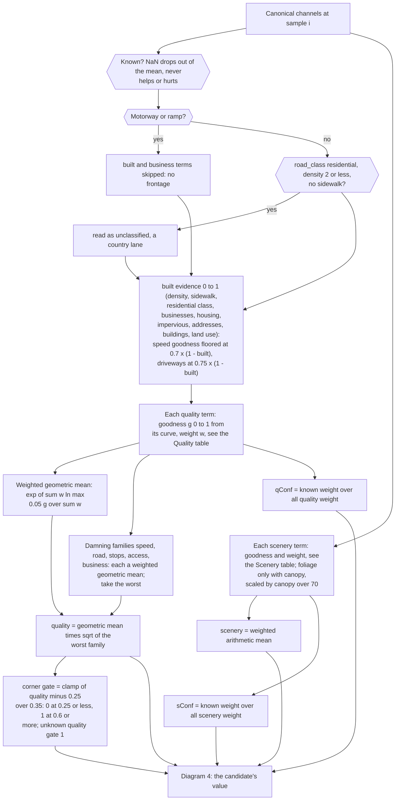
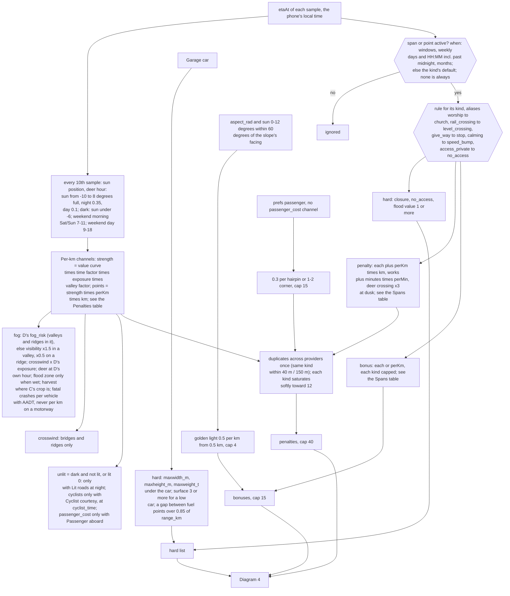
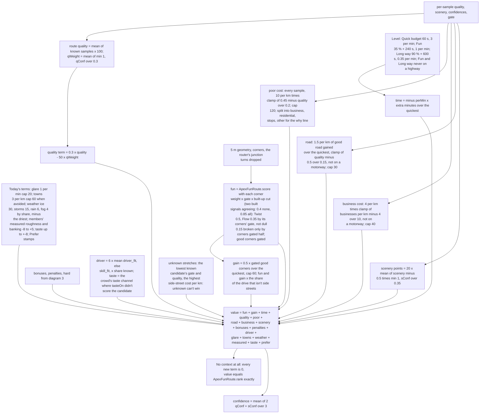

# The route engine

How Vetta decides which way is worth driving: `web/route_engine.js` (the model and the plan search's pieces),
`web/route_ctx/registry.js` (the route context: corridors, providers, one budget), and the providers in
`web/route_ctx/<name>.js`. This page is the reference for anyone adding a data source: the channel names, units and how
each one enters the model are below. docs/ROUTING.md says how the planner uses it; docs/ROAD_INTELLIGENCE.md §7 why.

## Why a model and not a curvature score

Kurviger and Calimoto rank by curvature with road-class switches ("avoid highways", "curvy level"); REVER by community
roads; the scenic and pleasant routing papers (Quercia et al.'s *Shortest path to happiness*, crowd-photo scenic routing,
road-network attractiveness learned from trajectories) by one attractiveness number per edge under a time budget. All of
them fold "is this road worth driving" and "is it twisty" into one score, which is exactly how a curvy subdivision wins:
five good corners in 1.3 km of Menominee Drive beat Pippin Road (the owner's bad case, now a test). The owner: "You can
build a curvy route with just road data but a good route takes road intelligence."

So every 25 m of a candidate gets two separate scores, and the corners only count where the road deserves them:

- **quality** (0–1): is this a road worth driving at all? Speed limit, class and use, density, signals, stops and
  crossings, driveways and side roads, traffic calming, businesses, land use, buildings, night lights, impervious ground,
  addresses, housing, noise, traffic volume, surface, crowd roughness and flow.
- **scenery** (0–1): what it's like: forest and canopy, water and creeks, ridges and relief, open country, parks, photos,
  autumn colour, old roads, loved roads, guardrails and curve signs, banking.

## Flowchart

How data becomes a ranking, as built (2026-11-04). Five linked diagrams: (1) sources and the context run, (2) per-25 m
quality and scenery, (3) penalties, bonuses and hard constraints, (4) a candidate's value, (5) candidates, ranking and the
why line. The weights in them are the code's; the tables in "Weights (checked against the code)" below are read back
from `web/route_engine.js`, `web/fun_route.js` and the providers by tests/test_route_engine_doc.py. Providers marked
All five builders' providers are merged and drawn with their real channel names; what isn't built is named in its box
(snowplough positions, city event permits, NC and VA work zones, FCC mobile coverage; FEMA flood zones are in C's grid,
only a live FEMA query isn't made).
A rendered copy for a phone: docs/design/route_engine_flow.html (`python3 tools/route_engine_flow.py` rebuilds it from
this page).

### 1. Sources, fetching and the context run

```mermaid
flowchart TD
  P["Plan: A to B, loop or Explore"] --> CAND["Candidates, see diagram 5"]
  CAND --> COR["Corridor per candidate: samples every 25 m,<br>heading, bbox, etaAt from the router's<br>maneuver clock, else its total time by<br>distance, else 50 km/h; times the live pace<br>0.6 to 1.8 while driving; the Garage car"]
  COR --> RUN["ApexRouteCtx.run: every provider at once on<br>all corridors of the plan; one budget, 4 s<br>for candidates, 1.2 s for stages; each<br>provider gets min of its budgetMs and what<br>is left, and an AbortSignal at the deadline"]
  RUN --> PH["Two phases: D's conditions, wildlife,<br>hazards-live and events, and E's car, start<br>when the rest has landed or at half the<br>budget, with their land use, terrain,<br>density, coverage and schools as<br>opts.channels, peer, places"]
  RUN --> A1["A router_edges.js, priority 10, 2.4 s,<br>stages too: one Valhalla trace_attributes<br>per candidate, walk_or_snap; stages map_snap<br>through our Worker's relay, kept 3 days per<br>shape; 6 in flight in all, kept 30 min per<br>line; at the deadline the lines that answered. speed_limit_kph, speed_limit_est_kph<br>flagged, speed_kph, road_class, road_use,<br>density, lanes, surface, sidewalk,<br>truck_route, bridge, tunnel, toll, ramp,<br>roundabout, signals_per_km, access_per_km,<br>intersections_per_km; points signal,<br>junction, driveway"]
  RUN --> A2["A dem.js, priority 20, 2 s, stages too: z12<br>Terrarium tiles, at most 64 a plan, shortest<br>corridors first. elev_m, grade_pct,<br>relief_m, tpi_m, aspect_rad, west_descent;<br>spans climb, descent"]
  RUN --> B1["B osm_tiles.js, 8 s:<br>lu_residential, lu_commercial, lu_retail,<br>lu_industrial, lu_forest, lu_farmland,<br>lu_open, lu_park, lu_mapped, water_near,<br>creek_follow, bldg_per_km, addr_per_km,<br>biz_per_km, junctions_per_km,<br>driveways_per_km, access_per_km, road_class<br>in map codes, on_bridge, in_tunnel, unpaved;<br>points school, worship, viewpoint, place,<br>rail_crossing, gate"]
  RUN --> B2["B osm_overpass.js, its tile cache; the<br>query by 0.05° tiles, never the route's<br>line, fills it off the plan's clock (our<br>Worker's relay built, flag osm_relay off):<br>maxspeed_kph, lanes, divided, oneway,<br>surface_paved, smoothness, hgv,<br>access_level, guard_rail, cycle_route,<br>byway,<br>signals/stops/crossings/calming_per_km,<br>side_roads_per_km, driveway_joins_per_km;<br>points signal, stop, give_way, crossing,<br>calming, level_crossing, curve_sign,<br>animal_crossing, buggy, viewpoint, historic,<br>fuel; spans roundabout, one_lane_bridge,<br>covered_bridge, access_private,<br>access_destination, cycle_route, byway"]
  RUN --> B3["B road_name_age.js: name_age"]
  RUN --> C1["C context_grid.js, 4 s, local bundles<br>web/data/ctx/v1 then the Worker's KV:<br>night_lights, impervious_pct, canopy_pct,<br>noise_db, housing_density,<br>population_density, address_density,<br>median_year_built, flood_zone,<br>cropland_class, park_visits, aadt, iri,<br>hpms_speed_limit, hpms_lanes, hpms_fclass,<br>crash_density; mobile_coverage (FCC, only<br>once built with the owner's token); spans nps_unit; points<br>fatal_crash"]
  RUN --> D1["D, second phase with the first's land use<br>and terrain: conditions.js, waits 0.8 s for<br>Open-Meteo then its cache: air_temp_c,<br>road_temp_c, visibility_m, fog_risk,<br>crosswind_mps, exposure, precip_6h/48h_mm,<br>wx_hazard, light, glare, golden_view;<br>wildlife.js deer_time_risk, deer_risk;<br>events.js event_crowd, school_zone,<br>school_bus_hour, church_window;<br>hazards_live.js flood_risk, works,<br>harvest_traffic, park_busy, foliage, spans<br>closure, works, flood, low-water, paving;<br>photos.js photo_score, sign_maxspeed_mps,<br>curve_sign. Not built: snowplough (no OHGO<br>endpoint), city permits (no public source),<br>NC and VA work zones (need keys); FEMA<br>flood zones come from C's grid"]
  RUN --> E1["E crowd.js, 9 s, second phase: members' data<br>by 0.1° cells, ways from the router's edges:<br>crowd_rough_g, crowd_bank_deg,<br>crowd_curv, crowd_conf, crowd_flow, loved,<br>taste, crowd_busy (quiet_hours flag, off);<br>needs lookupCells /api/roads?cells=,<br>crewLines"]
  RUN --> E2["E driver.js, 8 s: passenger_cost, tech_level,<br>skill_fit, dark, lit, cyclist_route,<br>cyclist_time, tunnel, driver_fit; spans<br>hairpins, abrupt, unlit_dark, cycle_route,<br>tunnel; For this drive prefs passenger,<br>lit, cyclists, tunnels"]
  RUN --> E3["E car.js, 8 s, fuel stations from its cache,<br>the Overpass query runs on: fuel_since_km, fuel_margin,<br>signal; spans fuel_gap hard, fuel_check,<br>no_signal; points fuel_stop, share_eta,<br>ask_range; needs apiGet /api/chargers"]
  RUN --> E4["E ios_context.js: free_min; span<br>past_next_event; point album_ends.<br>crew_meet.js: point crew_start"]
  A1 ~~~ A2 ~~~ B1 ~~~ B2 ~~~ B3 ~~~ C1 ~~~ D1 ~~~ E1 ~~~ E2 ~~~ E3 ~~~ E4
  A1 & A2 & B1 & B2 & B3 & C1 & D1 & E1 & E2 & E3 & E4 --> CLEAN["clean: wrong-length channels dropped, NaN is<br>unknown never 0; osm_tiles road_class<br>translated to router codes"]
  CLEAN --> MERGE["merge per channel per sample: lower priority<br>provider wins where it knows, the next fills<br>its gaps; spans and points pooled with their<br>source"]
  STAT ~~~ CANON
  MERGE --> STAT["status per provider: ok, partial,<br>unavailable, no-key, out of time; onUpdate<br>as each lands"]
  MERGE --> CANON["channel: canonical name, gaps filled from<br>aliases and other providers' names, e.g.<br>maxspeed_kph to speed_limit_kph, biz_per_km<br>to business_per_km, lu shares where<br>lu_mapped at least 0.3"]
  CANON --> S2["Diagram 2: per sample"]
  CANON --> CHAIN["speed limit chain: router, OSM maxspeed,<br>Mapillary signs, HPMS (all measured), then<br>the class estimate; HPMS lanes and class<br>fill gaps; D's visibility, crosswind, light<br>and park_busy and C's housing, year built,<br>park visits under the model's names"]
  CHOSEN["route chosen"] --> AFTER["car.js aftercare: ask_range asks once for<br>the car's range; no_signal stretches offer<br>to save their maps (offlineAreas,<br>prepareOffline), then share_eta offers<br>Share ETA"]
```

### 2. Per 25 m: quality, scenery, confidence

### 3. Time, penalties, bonuses, hard constraints

### 4. A candidate's value

### 5. Candidates, ranking, the why line

```mermaid
flowchart TD
  WT["Where to?"] --> DEF["Valhalla, the app's costing use_highways<br>0.15 (0 at Fun and Long way), tolls 0.3,<br>avoid chips, the car's width and clearance;<br>2 alternates"]
  WT --> HWY["Highway-friendly quickest use_highways 1.0,<br>unless Avoid Highways; trips of 2 km or more"]
  DEF -. "Valhalla down" .-> OSRM["OSRM fallback"]
  WT --> STG["Stages from the map tiles around the<br>corridor, sections on long trips"]
  STG --> NET["Network step: top 8 stages, 12 for Explore,<br>get router edges, map tiles, the grid and DEM<br>in 1.2 s; score x 0.4 + 0.6 x mean gate x 1 +<br>0.4 x scenery - 0.5 x known share; a sample<br>no source knew takes gate 0.4"]
  NET --> SL["shortlist in the level's ellipse, direction<br>by climb, set list"]
  SL --> MX["connector matrix with use_highways 0 at<br>Fun and Long way, avoid kept"]
  MX --> PL["plans of 1-2 stages within the level's<br>budget, routed through shaping points with<br>use_highways 0; dropped if under 70 % of a<br>stage is driven"]
  DEF ~~~ HWY ~~~ STG
  DEF & HWY & OSRM & PL --> POOL["pool: keep avoided roads out when any<br>candidate can"]
  DEF --> EARLY{{"the router answered"}}
  EARLY --> SHOW["the quickest goes up at once, replaced when<br>the ranking is ready unless driven or<br>replaced"]
  SHOW ~~~ CTXR
  POOL --> CTXR["context run, diagram 1, alongside the towns<br>lookup"]
  CTXR --> TOP["engine ranking picks the contenders for<br>weather (top 4), taste (top 4), members'<br>measurements (top 3), Prefer (top 4)"]
  TOP --> RANK["rank: value per candidate; drop past the<br>level's budget; Fun and Long way: only the<br>highway-free, else the least highway; drop<br>any with a hard constraint unless all have<br>one"]
  RANK --> OPT["up to 3 options, not within 30 s and 1<br>gated-fun point of one kept, none slower and<br>less fun"]
  OPT --> PIN["winner: an alternate or highway-costed route<br>is pinned with shaping points every 5-6 km<br>so a reroute keeps to it"]
  OPT ~~~ WHY
  PIN ~~~ LOOP ~~~ EXP
  RANK --> WHY["why line: the 2-3 parts that differ most<br>from the quickest: side streets or strip<br>malls avoided, highway instead of, good<br>corners, more good road, back roads at 45-55 mph, signals,<br>through forest, along the water, ridges,<br>deer hour, less in towns, drier, less low<br>sun; else the old roads and corners line.<br>A Fun or Long way pick that is the quickest:<br>no great roads on this trip. A pick another<br>option beats on the card's minutes and<br>corners: over that route, what it wins by"]
  LOOP["Loops: stage plans and a circle, routed;<br>same context run; value = loopValue on gated<br>fun - 2 per % retraced - 0.8 per % off<br>length + quality + scenery + bonuses - poor<br>- penalties - glare - towns + measured +<br>Prefer; a hard constraint -1000"] --> RANK2["best loop"]
  EXP["Explore: stages within reach, network step,<br>matrix times; listed best first"]
```

## Weights (checked against the code)

tests/test_route_engine_doc.py reads these from the code and fails if a row here drifts. The Quality and Scenery tables
under "The channels" are checked the same way (channel and weight).

| constant | value | meaning |
|---|---|---|
| QUALITY | 0.3 | points per quality point above or below 50, times qWeight |
| POOR_Q_HI | 0.45 | quality where the side-street cost starts |
| POOR_Q_LO | 0.25 | quality where it is full |
| POOR_PER_KM | 10 | points per km at full |
| POOR_CAP | 120 | the most it costs |
| END_GRACE_M | 0 | metres free at each end (none: a plan that drives 2 km of strip mall out of town pays for it) |
| BUSINESS_PER_KM | 4 | points per km of business district at full, never beside a motorway or ramp |
| BUSINESS_FROM | 4 | businesses per km where that cost starts |
| BUSINESS_FULL | 14 | businesses per km where it is full |
| BUSINESS_CAP | 40 | the most it costs |
| GOOD_Q_LO | 0.5 | quality where good road starts to count (the good road gained) |
| GOOD_Q_HI | 0.65 | quality where it counts in full |
| GOOD_PER_KM | 1.5 | points per km of good road gained over the quickest, never a motorway or ramp |
| GOOD_CAP | 30 | the most it adds |
| SCENERY | 20 | points for scenery 1 vs 0.5, times how much is known |
| Q_FULL_CONF | 0.3 | share of quality weight known for full weight |
| S_FULL_CONF | 0.2 | share of scenery weight known for full weight (land use alone counts) |
| STAGE_UNKNOWN_GATE | 0.4 | the gate a stage's samples take where no provider knew the road (the network step) |
| GATE_LO | 0.25 | quality at which a corner counts nothing |
| GATE_HI | 0.6 | quality at which a corner counts in full |
| BUILT_LO | 0.4 | built evidence (two signals agreeing) where a corner starts to count less: corners between houses |
| BUILT_HI | 0.85 | built evidence where the cut is full |
| BUILT_CUT | 1 | the share of a corner's gate the cut takes at BUILT_HI (a street lined with houses: none of it) |
| PENALTY_CAP | 40 | the total penalties saturate softly toward this |
| BONUS_CAP | 15 | the most bonuses add |
| DRIVER | 6 | points for driver_fit (else skill_fit) 1 vs 0, times the share known |
| LOG_FLOOR | 0.05 | the lowest goodness in the geometric mean |
| SPEED_FLOOR | 0.7 | speed goodness floor in open country (× 1 − built evidence) |
| ACCESS_FLOOR | 0.75 | driveway goodness floor in open country (× 1 − built evidence) |
| KIND_CAP | 12 | each kind of penalty saturates softly toward this |

| per-km penalty | points per km |
|---|---|
| deer_risk | 1.5 |
| fog_vis_m | 1.2 |
| fog_risk | 1.2 |
| crosswind_ms | 0.6 |
| road_temp_c | 0.6 |
| crash_density | 0.6 |
| cyclist_route | 0.5 |
| buggy | 0.8 |
| unlit | 0.6 |
| crowd_busy | 0.6 |
| park_visitors | 0.5 |
| signal_coverage | 0.4 |
| event_crowd | 2 |
| school_zone | 3 |
| school_bus_hour | 0.8 |
| church_window | 1 |
| harvest_traffic | 0.5 |
| flood_zone | 2 |
| passenger_cost | 1.5 |
| fuel_margin | 0.5 |

| span or point | each | per km | bonus | bonus per km | cap | hard |
|---|---|---|---|---|---|---|
| closure |  |  |  |  |  | yes |
| no_access |  |  |  |  |  | yes |
| flood | 5 |  |  |  |  | value 1 or more |
| school | 2 | 1 |  |  |  |  |
| church | 1 |  |  |  |  |  |
| event | 6 |  |  |  |  |  |
| works | 4 |  |  |  |  |  |
| harvest |  | 0.5 |  |  |  |  |
| byway |  |  |  | 0.4 | 12 |  |
| level_crossing | 0.7 |  |  |  |  |  |
| one_lane_bridge | 0.5 |  |  |  |  |  |
| animal_crossing | 0.3 |  |  |  |  |  |
| speed_bump | 0.5 |  |  |  |  |  |
| stop | 0.4 |  |  |  |  |  |
| viewpoint |  |  | 1.5 |  | 6 |  |
| covered_bridge |  |  | 2 |  | 4 |  |
| historic |  |  | 0.5 |  | 3 |  |
| tunnel |  |  | 1.5 |  | 4.5 |  |
| resurfaced |  |  |  | 0.3 | 3 |  |
| fuel_gap |  |  |  |  |  | yes |
| past_next_event | 0 |  |  |  |  |  |
| gate | 1 |  |  |  |  |  |
| ice |  | 3 |  |  |  |  |
| buggy | 0.5 |  |  |  |  |  |
| curve_sign |  |  | 0.2 |  | 2 |  |
| access_destination | 1 | 2 |  |  |  |  |
| cycle_route |  | 0.5 |  |  |  |  |

| level | budget | slack s | points per extra minute |
|---|---|---|---|
| quick | 0 | 60 | 3 |
| fun | 0.35 | 240 | 1 |
| max | 0.9 | 600 | 0.35 |

## The model

### Per sample

`samples(corridor, ctx)`:

- **Quality** is a weighted *geometric* mean of every known quality term's goodness (each term maps its value to 0 worst
  … 1 best), times the square root of the worst of the *damning* families (speed, road, stops, access, business). The
  geometric mean means a 0.1 is not averaged away by five 1.0s; the soft minimum means plenty of absent signals can't make
  a 25 mph side street, a driveway every 30 m or a row of shops a good road. Values on real roads (Cincinnati fixtures):
  country back roads 0.6–0.85, interstates 0.65–0.75, suburban collectors 0.3–0.45, subdivisions 0.1–0.25, strip-mall
  arterials 0.05–0.25.
- **A low limit damns a road only where the built signals agree.** Each sample's built evidence (0 open country … 1 town)
  is the most built of: router density, sidewalks, a residential or service road, businesses, housing, impervious ground,
  addresses, buildings, residential or urban land use. The speed family's goodness is floored at 0.7 × (1 − built) and the
  driveway family's at 0.75 × (1 − built): a 30 mph primary through forest (the Dragon kind) keeps quality ~0.7 and its
  corners; the same road built up does not. Unknown built evidence: no floor.
- A motorway or ramp has no frontage: the built and business terms (shops, houses, lights beside it) and its traffic
  volume, noise and trucks are skipped there.
- A "residential" road with router density ≤ 2 and no sidewalk is read as a country lane (US TIGER imports tag county
  roads residential), class unclassified and an estimated 35 mph.
- **Scenery** is a weighted arithmetic mean (one nice thing is nice).
- **Confidence** per sample is the share of the possible weight that was known. Unknown terms drop out of both means.

### Per candidate

`evaluate(cand)` adds up, along the corridor:

| term | what | points |
|---|---|---|
| fun | ApexFunRoute.score with each corner's weight times the **quality gate** where it is (0 at quality ≤ 0.25, full at ≥ 0.6) times the **built-up cut** (`builtEvidence(ctx, true)`, what two built signals agree on: full at 0.4 or less, nothing at 0.85 or more: a street lined with houses has no fun corners); Flow counts each run by its corners' mean gate and only a corner gated at least half breaks a dull straight | 0–100 |
| gain | 0.5 × gated good corners gained over the quickest (cap 60), as before | ≤ 30 |
| quality | 0.3 × (route quality − 50) × how much is known (full once a third of the weights is known) | ±15 |
| scenery | 20 × mean(scenery − 0.5) weighted by how much of it is known (full at 35 %) | ±10 |
| poor | −10 per km of side street or business district: smooth from quality 0.45 down, full at 0.25; cap 120 | ≤ 0 |
| road | +1.5 per km of good road gained over the quickest (smooth from quality 0.5, full at 0.65; never a motorway or ramp; cap 30). The side street's cost has a length, so the good road a longer way buys has one too (2026-11-08: 11 km more of the best road counted only as a higher mean, and 3 km more suburb outweighed it at Long way) | 0–30 |
| bonuses | byways 0.4/km (cap 12), viewpoints 1.5 (cap 6), a covered bridge 2, history 0.5, a waterfall 1, tunnels 1.5 (if preferred), fresh asphalt 0.3/km, golden light on west-facing ground (0.5/km, cap 4); all bonuses cap 15 | ≤ 15 |
| penalties | per km and per span at the time you'd be there (below); each kind saturates softly toward 12 (KIND_CAP: deer alone can't fill it, a longer deer road still costs more), the total toward 40 | ≥ −40 |
| time | − the level's perMin × extra minutes (Quick 3, Fun 1, Max 0.35) | |
| glare, towns, weather, measured, taste, prefer | today's terms, unchanged: glare 1/min (cap 20), towns 3/km (cap 60, when avoided), weather (ice 30, storms 15, rain 6, fog 4 by share, relative), members' roughness/banking −8…+5, taste ±8, the Prefer stamps | |

The route card's why line (cockpit.js optionOnto) is `why(best, quick)`; for the ranking's pick it adds more: at Fun and
Long way the highway line first, `whyHighway` ("Uses 0.4 mi of I-275 (no other way across)" for the exception; "No
highway-free way in a sensible time; Quick is the way" alone when the highway-free way is over twice the quickest's time);
a Fun or Long way pick that is the quickest (or within a minute of it) says so, `whyQuickest`: "No great roads on this
trip: Quick is the way" (or "The quickest way is the best road here too" with 5 good corners or more), and one that is the
quickest way off the highway: "No great roads on this trip: this is the quickest way off the highway"; and a pick that another
option on the card beats on its own numbers (`ApexFunRoute.dominates`: no slower in the card's minutes, more corners)
says what it wins by, `whyOver`: "Over the 34 min route: less low sun". The card never shows a pick that looks strictly
worse without a reason.

`value` is their sum; `rank` takes the quickest and the budget from the candidates that can be driven, drops those past
the budget and any with a hard constraint; **at Fun and Long way it keeps only the candidates with no motorway or trunk
road** (fun_route.js `applyHighways`: at most 0.1 km by `highwayKm`, our router's own count, else the context's road
class; the owner, 2026-11-08: "fun should never go on the highway"), else, where none is highway-free, those within 0.3
km of the least highway (the exception); the budget then opens to the quickest of them + 60 s, the quickest it is measured
against stays the true quickest (`ranked.quickest`, for the why line), and the picks carry `hwyRule`, `hwyKm`,
`hwyAbsurd` (the highway-free quickest over 2x the quickest's time) and `hwyFreeS`; if every candidate breaks one, the least bad (fewest) stays, flagged, and the
route card says what (never an empty ranking). **Unknown data can't win:** where a candidate's road quality is unknown
(or only in part) and others' is known, its unknown stretches take the lowest known candidate's corner gate and quality
and the highest side-street cost per km. **With no context at all the value is
exactly ApexFunRoute.rank's**, value for value (tests/test_route_engine.py runs 600 random pools): when every provider is
slow or down, routing is today's.

### Time-dependent penalties

Each sample has `etaAt` (the router's maneuver clock placed on the line, else its total spread by distance, else 50 km/h;
times the driver's live pace while driving). At that time, in the local time of the place (ctx_util.js `localTime`, the
sample's own zone, not the phone's):

| term | when | cost |
|---|---|---|
| `deer_risk` | D's rate (1 = the average hour) with the hour in it; × 0.25 on motorways and ramps | 1.5/km at 4× |
| `fog_vis_m` | as forecast; ×1.5 in a valley (TPI ≤ −10 m), ×0.5 on a ridge (TPI ≥ 20 m) | 1.2/km below 1 km |
| `crosswind_ms` | on bridges and ridges only | 0.6/km over 8 m/s |
| `road_temp_c` | cold tyres | 0.6/km below 7 °C |
| `cyclist_route` | Sat/Sun 7–11 | 0.5/km |
| `park_visitors` | Sat/Sun 9–18 | 0.5/km |
| `unlit` | after dusk (sun < −6°), only with the "avoid unlit roads" preference | 0.6/km |
| school spans | Mon–Fri 07:00–08:45 and 14:00–16:15, Aug–Jun (unless the span says) | 2 + 1/km |
| church spans | Sun 08:00–12:30 | 1 |
| event spans | the span's own windows | 6 |
| works spans | always (or its window) | 4 + the delay in minutes × perMin |
| harvest spans | Sep–Nov, 07:00–20:00 | 0.5/km |
| level crossings, one-lane bridges, deer crossings (×3 at dusk), speed bumps, stop signs | points | 0.7, 0.5, 0.3, 0.5, 0.4 each |
| a passenger aboard | hairpins and 1–2s | 0.3 each (cap 15) |

A span or point may carry `when: { windows: [[startMs, endMs]], weekly: [{ days: [0–6], from: 'HH:MM', to: 'HH:MM' }],
months: [1–12] }` (weekly windows may wrap midnight); none means always, or the kind's default above.

### Hard constraints

A `closure` or `no_access` span active at the time; `flood` with value ≥ 1 (water over the road); a car that doesn't fit
(`maxwidth_m`, `maxheight_m`, `maxweight_t`, from OSM maxwidth / maxheight / maxweight via osm_overpass.js, under the
Garage car's width, height or weight); unpaved (`surface` ≥ 3) for a low car; car.js's `fuel_gap` span (longer than the
car's safe range between stations), hard only where every station tile along it answered (else `fuel_unsure`, said).
Duplicates across providers count once: the same kind within 40 m (signals, stops, crossings) or 150 m (spans and other
points), with kinds normalised (`rail_crossing` = `level_crossing`).

### The why line

`why(best, quick)` takes the parts of the value that separate the winner from the quickest most and says the top 2–3:
"Highway instead of 1.2 mi of side streets"; "Avoids 2.1 mi of strip malls · 6 signals (not 18), +1 min"; "14 more good
corners · back roads at 45–55 mph · through forest, +4 min"; "6.6 mi more good road" (the road part); "Deer hour: open
roads"; "1.9 mi less in towns". It never
names scenery (forest, water, ridges) when the winner drives 0.3 km or more of business district beyond the quickest's,
and "avoids X of strip malls" is in that kind's km. When the winner is simply the better road (shallower side streets,
a higher mean quality) and nothing else separates them: "Better roads than the quickest". When nothing the context
knew made the difference, the old line (the roads it's for and its corners) is said.

## The plan search

- **Levels** (the owner, 2026-11-08: "fun should never go on the highway. Quick should essentially be a normal route"):
  Quick is the quickest way, highways welcome, a nicer road only within a minute (budget 0 + 60 s); Fun and Long way never
  drive a motorway or trunk road (or their links): a hard rule in our router (graph_router.js `K.NO_HWY`, OWN_ROUTING.md
  §5) and in the ranking (above), with the one exception where no way without one exists (a river crossed only by an
  interstate bridge, a start or end on a ramp): the shortest highway link, said on the card.
- **Candidates**: the router's route and two alternates (its costing keeps off highways, use_highways 0 at Fun and Long
  way: `levelCosting`); **the highway-friendly quickest** (`highwayCosting`, use_highways 1.0) unless the driver avoids
  highways, which is what fixes routes through subdivisions and business districts at Quick, and is every level's measure;
  stage plans; loops; Explore.
- **The network**: before plans are timed, the 8 best stages (12 for Explore) get the stage-capable providers (the
  router's edges by map matching, the map tiles' land use, shops and road class, the context grid, the DEM) in 1.2 s,
  and `rescoreStages` multiplies each stage's map score by (0.4 + 0.6 × its mean corner gate) × (1 + 0.4 × (scenery −
  0.5)): a twisty subdivision street falls to 40 % and behind a real back road before any connector is timed. A sample
  no provider knew takes gate `STAGE_UNKNOWN_GATE` (0.4), and a stage with no answer at all while others have one the
  same: a stage is trusted only as far as something vouches for it (live, the router out of time left stages on their
  map score and a Colerain Avenue stage was planned). A stage the context shows is mostly a neighbourhood street
  (`streetOf`, fun_route.js `streetSample`), or one our graph tiles' model scores under 0.45 on average, gets
  `notRoad` and sorts last; Best roads nearby never lists it (ROUTING.md "Explore").
- **Connectors**: the matrix and the stage plans' routes use `levelCosting` (use_highways 0 at Fun and Long way, where
  they are made; `connectorCosting`'s 0.6 at Quick; avoid-highways kept); loops `loopCosting` (0.25 Quick, 0 Fun and Long way):
  the good roads are pinned by shaping points, so this only changes how the plan gets between them: fast roads, not
  cut-throughs. A detour must then buy real quality: its gated corners, quality and scenery against its minutes.
- **The quickest always competes**; if the alternatives are worse roads, it wins.
- A winning router alternate or highway-costed route is pinned with shaping points, so a reroute keeps to it.
- **Loops** and **Explore** use the same model (`loopValue`, `rescoreStages`).

## Instant

Where to? never waits on the context (REVIEW_FEEL budgets): the providers get 4 s together for the router's routes
(1.2 s for stages, 1.8 s for each stage plan once routed), each provider within its own budget and an AbortSignal; what
came back is used and the rest is unknown. The quickest route goes up as soon as the router answers (about 1.5 s with
its track built) and the ranked routes replace it when they're ready, unless you've started driving it or planned
something else.

What runs alongside what (live, 2026-11-04; the 11-16 s plans of #292 came from waiting in turn): the stages round the
trip are found while the router routes; the router's own routes get their context while the stages are scored, timed
and routed; only the stage plans' context (1.8 s at most) and the forecasts (asked with it, waited on 0.4 s past it)
follow the routing. Three public services never sit on the plan's clock: Overpass (map features and fuel stations, the
cache only; the query runs on and fills it for the next plan), Open-Meteo for conditions (0.8 s, then the cache), and
the trip forecast (2.5 s, then nothing for anyone). trace_attributes asks `walk_or_snap` in one request: an exact edge
walk answers 400 (error 443, "edge_walk algorithm failed to find exact route match") on every line routed through
shaping points, so stage plans used to cost a failed request and a second one each.

The first route and the page's thread (2026-11-04, the speed passes): the router's first answer goes up on its own,
whichever of the two requests lands first (the highway-costed one, with no alternates, is often 0.4 s ahead; the weather
and the context don't hold it), with 0.1 s for the land cover beside it (past that the
cautious sight lines, and the ranked route is built in full). Until it is up (1.8 s at most) the context runs and the
stages' network step wait, so the page and the public router serve it first. Stage discovery (decoding the map tiles and
scoring every stroke, 2-4 s) runs in `web/stages_worker.js`, off the page's thread, and is kept 10 minutes per area for
re-plans in the worker itself (the page never copies the list while it draws a route); the whole trip and its sections are planned at the same time; each stage plan's context starts as it is routed;
the router's edges keep six requests in flight across all the plan's runs at once (ten made the public server slow every
one of them); a map tile is fetched and decoded once however many runs want it, and the tiles along the straight line
are fetched while the router routes (bytes only: decoded when the context runs); the stage ends' heights load alongside the network step; the leading router route's
track is built while the stage plans are still being scored. The stages' router edges come through our Worker
(`GET /api/ctx/trace?shape=`, backend/src/trace_relay.ts), kept 3 days per shape: a stage is a stretch cut from the map
tiles, the same for everyone near it, so the next plan nearby has its edges at once; the driver's own routes still go
from the phone to the public router.

Stopping early, checked (2026-11-04): a stage plan could be dropped before its context only if what that context can add
can't close its gap to the leader. With nothing known, the context can add up to quality +15, scenery +10, bonuses +15,
driver +6, and fun and gain at full share instead of scaled by it: 77-104 points on the live captures, against gaps of
1.3-63 points (Colerain Max: Blue Rock leads the Cross County plan by 1.3). No plan is provably out, so every routed plan
gets its context; capping each family's swing tighter would be a different model, not a bound.

### Overpass off the critical path: what a first plan in an area doesn't have

From production the public Overpass servers answered 502 without CORS (overpass-api.de) or 504 (maps.mail.ru) on every
run, so the phone could rarely read them. A relay on our Worker is built but OFF (backend/src/osm_relay.ts, server flag
`osm_relay`): `GET /api/ctx/osm?bbox=` takes one 0.05° tile, races the four mirrors server-side (9 s each), answers only
the tags the phone reads and keeps each tile a week; `?diag=1` reports each mirror's status and time. On the preview
(2026-11-04) every mirror refused the Worker or timed out (overpass-api.de 521 in 0.25 s, kumi and private.coffee 9 s
timeouts, maps.mail.ru 504 in 1.5 s), and the own-routing graph ETL takes the same features from the Geofabrik extract.
With the flag off (the default) the phone asks Overpass itself off the plan's clock, from its tile cache; with it on, it
asks the relay first and falls back to that. What a plan lacks for tiles not cached yet, and what covers it:

| Overpass channel | covered by |
|---|---|
| maxspeed_kph, lanes, signals_per_km, side_roads_per_km, driveway_joins_per_km, roundabout, hgv | the router's edges (speed_limit_kph from the same OSM maxspeed, lanes, signals, intersections and access per km, truck_route) and osm_tiles (junctions, driveways and access per km) |
| surface_paved | the router's surface and osm_tiles' unpaved |
| level_crossing, viewpoint points | osm_tiles (rail_crossing, viewpoint) |
| stops_per_km, stop and give_way points | not covered: stop signs are only in Overpass (unknown, so no cost and no credit) |
| crossings_per_km, calming_per_km, guard_rail, smoothness, byway, cycle_route, divided, oneway | not covered (unknown) |
| maxheight_m, maxwidth_m, maxweight_t | not covered: a car-fit limit is unknown, never enforced, until the cache has the tile |
| one_lane_bridge, covered_bridge, access_private, access_destination spans; curve_sign, animal_crossing, historic, fuel points | not covered (photos.js has curve signs with a Mapillary key; car.js asks Overpass for fuel the same way, from its cache) |

## Calibration

`tools/route_engine_fixtures.js` captures real cases (the router's candidates under both costings and any stage plan,
each candidate's edges from trace_attributes, its terrain from the real DEM tiles, the businesses beside it from the
OpenFreeMap poi layer; Overpass was unreachable from the capture machine) into `tests/fixtures/route_engine/`, and
`tests/test_route_engine_calibration.py` asserts the order a driver would pick (`tests/route_engine_harness.js` rebuilds
each case as the app would):

| case | candidates | engine | old ranking |
|---|---|---|---|
| subdivision (Pippin Road vs Menominee Drive, 5 good corners in 1.3 km) | 5.6 min vs 9.2 min | Pippin Road at every level | Menominee at Fun and Max |
| northgate (Springdale and Mill Roads vs I-275) | 12.0 / 14.4 / 14.7 vs I-275 11.4 min | I-275 at Quick; Springdale and Mill Roads at Fun and Long way (never the highway, 2026-11-08) | Pippin and Kemper at Fun and Max |
| colerain (Colerain Avenue: 18 signals, 244 businesses beside it) | 17.6 vs Pippin and Struble 19.0, Blue Rock 21.2 | Colerain Avenue at Quick (the quickest: Quick is the normal route since 2026-11-08), Pippin and Struble or Blue Rock at Fun and Long way | Colerain Avenue |
| harrison (the fixture drive's country) | I-275/I-74 22.0 vs Lees Creek and Day Roads 26.1 | the highway at Quick, the back roads at Fun and Max | the same |

Live captures (`tools/route_engine_live.js` in headless Chromium against the real services, FIXTURES=…) in
`tests/fixtures/route_engine_live/`: the candidates the app's own planner ranked, the router's and the stage plans it
routed, with the context every provider returned. `tests/test_route_engine_live.py` (all five fail on #292):

| live case | #292 picked | now |
|---|---|---|
| northgate, Fun (stage plans incl. W Kemper, Colerain Avenue 3.7 km, Bank Road) | the Colerain Avenue stage plan at Fun and Max, "through forest" | I-275 at Quick; Springdale and Mill Roads at Fun and Long way (2026-11-08) |
| colerain, Quick and Fun captures (Colerain Avenue 3.6 km vs Pippin and Struble, Blue Rock) | Colerain Avenue at Quick; a Colerain Avenue route at Max | Colerain Avenue at Quick (the quickest, 2026-11-08; Pippin and Struble are 1.4 min more), Blue Rock Road at Fun and Max, "Avoids 1.5 mi of strip malls" |
| harrison, Fun | the same | I-275 and I-74 at Quick, New Haven, Day and Lees Creek Roads at Fun and Max |
| subdivision4 (4 km across Groesbeck, the router's quickest cuts through Cornwall and Comstock Drives) | | the cut-through at Quick only; Miles and Struble Roads at Fun and Max, "Better roads than the quickest" |

What changed for them: the side-street cost has no grace at the ends and counts 10 a km (cap 120); business districts
cost on their own (4 a km at 14 businesses a km and more, never beside a motorway); corners and their gain count by the
share of the drive that isn't side streets, so 3 km of back road reached through 6 km of suburbs and shops doesn't
outscore the highway.

Property tests (tests/test_route_engine.py): no context = the old ranking exactly; a channel all unknown changes nothing;
every quality term monotonic in the right direction and the route value with it (speed limit up never hurts; businesses,
signals, driveways, density up never help); every catalogue channel below moves the ranking the right way; the time
windows, bonuses, hard constraints and the why line.

## The channels

Builders: **A** router edges and DEM (`router_edges.js`, `dem.js`, built); **B** map tiles and OSM/Overpass features;
**C** the national-data grid; **D** time and world (weather, sun, deer, events, flood, works); **E** driver, crowd and
in-car. Per sample unless marked span/point. NaN is unknown, never 0. A channel two providers give is merged per sample:
the lower `priority` provider wins where it knows, the other fills its gaps.

### Quality (weight; goodness)

| channel | unit | from | weight | goodness |
|---|---|---|---|---|
| `speed_limit_kph` | km/h | A | 3 | 30→0, 40→0.03, 56→0.35, 72→0.7, 89→0.95, 105→1 (never falls with speed) |
| `speed_limit_est_kph` | km/h | A (flag: an estimate) | 1.2 | the same, only where no limit is posted |
| `speed_kph` | km/h | A | 0.8 | the same, only where neither limit is known |
| `road_class` | 0 motorway … 7 service | A | 2 | 0.55, 0.6, 0.65, 0.85, 0.95, 0.85, 0.12, 0.05 |
| `road_use` | Valhalla use code | A | 2 | road 1, ramp 0.6, track 0.3, driveway/parking/alley/living street 0, service 0.08 |
| `density` | 0–15 | A | 2 | ≤2 → 1, 6 → 0.55, 11 → 0.05 |
| `signals_per_km` | /km (±500 m) | A (B fills) | 2 | e^(−n/1.5) |
| `stops_per_km` | /km | B | 1.5 | e^(−n/1.5) |
| `crossings_per_km` | /km | B | 0.8 | e^(−n/2.5) |
| `access_per_km` | side roads and driveways /km | A (B fills) | 1.5 | e^(−n/25) |
| `calming_per_km` | speed bumps, chicanes /km | B | 2 | e^(−n/0.7) |
| `lanes` | count | A | 0.5 | ≤2 → 1, 4 → 0.6, 6 → 0.5 |
| `divided` | 0/1 | B | 0.4 | 0.6 if divided |
| `surface` | 0 smooth … 7 impassable | A | 1 | paved 1, rough 0.7, compacted 0.4, gravel 0.2, dirt 0.15 |
| `sidewalk` | 0/1 | A | 0.7 | 0.3 with |
| `truck_route` | 0/1 | A (B: hgv) | 0.4 | 0.7 if a truck route |
| `access_destination` | 0/1 | B | 2 | 0.1 if destination-only |
| `business_per_km` | /km within 80 m, excluding fuel and cafés | B | 2.5 | e^(−n/6) |
| `landuse_urban` | share commercial/retail/industrial | B | 1.5 | 1 − v |
| `landuse_residential` | share | B | 1 | 1 − 0.8 v |
| `night_lights` | 0–1 Black Marble brightness | C | 0.6 | ≤ 0.15 → 1, 0.6 → 0.4, 1 → 0.3 (saturates in suburbs: dark vs lit) |
| `impervious_pct` | NLCD % | C | 1 | 5 → 1, 50 → 0 |
| `address_per_km` | /km | C | 1 | e^(−v/40) |
| `address_density` | address points /km² | C | 1 | e^(−v/500), only without `address_per_km` |
| `housing_per_km2` | Census housing units /km² | C | 0.8 | e^(−v/300) |
| `noise_db` | BTS road noise dB | C | 0.6 | 50 → 1, 70 → 0 |
| `aadt` | vehicles/day (HPMS) | C | 1.5 | ≤1000 → 1, 25 000 → 0 (log) |
| `iri` | HPMS IRI in/mi | C | 0.8 | 60 → 1, 200 → 0 |
| `crowd_rough_g` | members' rms g | E | 1 | 0.05 → 1, 0.38 → 0 |
| `crowd_flow` | 0–1 | E | 1 | v |

Families for the soft minimum: speed (the limits), road (class, use, lanes, divided, truck, destination), stops
(signals, stops, crossings, calming), access, business (businesses, urban land use). Built: density, sidewalk, buildings,
lights, impervious, addresses, housing, residential land use.

### Scenery (weight; goodness)

| channel | unit | from | weight | goodness |
|---|---|---|---|---|
| `forest_share` | 0–1 within 100 m | B | 1.5 | v |
| `canopy_pct` | NLCD tree canopy % | C | 1.2 | 0 → 0.15, 70 → 1 |
| `water_near` | 0–1 | B | 1 | v |
| `creek_follow` | 0/1 (a stream within 150 m, parallel) | B | 1 | 1 / 0.35 |
| `open_country` | farmland/grass share | B | 0.6 | 0.4 + 0.45 v |
| `protected` | 0/1 park or protected area | B | 1 | 1 / 0.4 |
| `photo_score` | 0–1 (Commons spots) | D | 1 | v, only where router density < 4 (towns are photographed too) |
| `curve_sign` | 0/1 after a curve-warning sign | D (Mapillary) | 0.6 | 1 / 0.5 |
| `grade_pct` | % along travel | A | 0.6 | \|v\|: 0 → 0.3, 6 → 1 (climbs and descents) |
| `tpi_m` | m (+ ridge, − valley) | A | 0.8 | \|v\|: 0 → 0.25, 40 → 1 |
| `relief_m` | m within 800 m | A | 1 | 10 → 0.1, 150 → 1 |
| `foliage` | 0–1 autumn colour near its peak, already × canopy | D | 0.8 | v |
| `built_year` | median year built (block group) | C | 0.6 | 1900 → 1, 2000 → 0.2 |
| `loved` | 0–1 (drive-it-again, votes, crew favourites, stages) | E | 1.5 | v |
| `guardrail` | 0/1 | B | 0.6 | 0.9 / 0.5 |
| `crowd_camber_deg` | ° into the corner | E | 0.5 | −3 → 0, 0 → 0.5, 4 → 1 |
| `name_age` | −1 subdivision name … +1 old-road name | B | 0.5 | 0.5 + 0.5 v |

### Penalties per km (see the time table above)

See the per-km table under Weights: each channel, its points per km at full strength, and the time it applies.

### Spans and points (`kind`)

See the spans table under Weights. Shown, not ranked: `signal`, `junction`, `driveway` (their per-km channels rank them),
`climb`, `descent`, `bridge`, `toll`, `roundabout`, `unpaved`, `fuel`, `fuel_stop`, `fuel_check`, `fuel_unsure`,
`no_signal`, `share_eta`, `ask_range` (acted on when a route is chosen). Any span with `hard: true` is hard.

### Not available (no provider emits it, or not before a drive)

| item | why |
|---|---|
| live traffic in planning | no free source: Apple MapKit timing runs on the iPhone during a drive (traffic detours); no free keyless service times candidates before one |
| VIIRS radiance (`night_light`) | C ships Black Marble brightness (`night_lights`, 0–1) instead: used. With the owner's Earthdata token the ETL builds it from VNP46A4 annual radiance as min(1, (r / 20) ** 0.7), on the 2016 image's scale (tools/ctx_etl/transforms.py NIGHT_SAT) |
| buildings per hectare | B's `bldg_per_km` (within 60 m) is the building term |
| Mapillary limits as their own channel | D's `sign_maxspeed_mps` is in the speed-limit chain (measured, after OSM, before HPMS) |
| truck share (`hgv_share`) | no public source per road; the router's `truck_route` and OSM `hgv` stand in |
| all-crash rate | not processed: state crash files (Ohio's OSHP records among them) are public but tools/ctx_etl builds only FARS fatal crashes into C's grid (`crash_density`, per vehicle), which are used |
| photos per km | D's `photo_score` (from `photo_spots`, saturating) is the photo term; `photo_spots` itself is shown |
| curve signs per km, `old_road` | D's `curve_sign` channel and B's `curve_sign` points; B's `name_age` replaces the old-road flag |
| snow cover, snowplough positions | no public source: OHGO's public API has no plough endpoint (its v1 resources are cameras, construction, slowdowns, signs, incidents, delays, truck parking and weather sites); snow and ice codes are the weather term, D's frost is the `ice` span |
| waterfalls, unploughed spans, cameras as a ranking term | waterfalls: no provider is built (OSM `waterway=waterfall` points would be one, not wired); unploughed spans: no public source; cameras: an owner decision kept as a router avoid (Avoid → Cameras), not a cost |
| FEMA flood zones | built, not missing: C's grid carries FEMA's flood class (`flood_zone`, the NFHL in the bundles), costed only when D says it's wet (48 h rain ≥ 25 mm or `flood_risk` ≥ 0.5). Only a live query of FEMA's NFHL service per plan isn't made: the bundles are its copy |
| city event permits | no public source: Cincinnati's open data has building and right-of-way permits but no street-closure or special-event permits, Columbus none (events.js) |
| NC and VA work zones | needs owner keys: NCDOT's and VDOT's work-zone feeds take a registered key (hazards_live.js), and the provider isn't wired for them until there is one; KY comes through our server, OH with the owner's OHGO key |
| FCC mobile coverage (`mobile_coverage`) | built by tools/ctx_etl (sources.MobileCoverage) when the workflow has the owner's FCC_USERNAME + FCC_API_TOKEN secrets (2026-11-08); until a grid is rebuilt with them the channel is NaN everywhere, so it never counts for or against a route |
| `crowd_curv`, `crowd_conf`, `tech_level`, `free_min`, `intersections_per_km`, `fuel_since_km` | said or used elsewhere: members' curvature corrects corners on the drive, `tech_level` is inside `driver_fit`, `free_min` sizes loops (My free time), junctions are inside `access_per_km` |

### Other providers' names (builder B's OSM providers, mapped as they are)

`route_engine.js` `SOURCES` fills a canonical channel, where it is unknown, from these (first known wins; the router's
own values come first): `maxspeed_kph` → `speed_limit_kph`; `biz_per_km` → `business_per_km`; `addr_per_km` →
`address_per_km`; `side_roads_per_km` + `driveway_joins_per_km` → `access_per_km`; `lu_residential` →
`landuse_residential`; `lu_commercial` + `lu_retail` + `lu_industrial` → `landuse_urban`; `lu_forest` → `forest_share`;
`lu_farmland` + `lu_open` → `open_country`; `lu_park` → `protected` (all land-use shares only where `lu_mapped` ≥ 0.3:
unmapped is unknown); `on_bridge`/`in_tunnel` → `bridge`/`tunnel`; `smoothness`, `surface_paved`, `unpaved` →
`surface`; `hgv` (2 designated) → `truck_route`; `access_level` (≥ 1) → `access_destination`; `guard_rail` →
`guardrail`; `cycle_route` (> 0) → `cyclist_route`. Their own: `bldg_per_km` (quality, built, e^(−n/40)), `name_age`
(scenery, weight 0.15, a weak prior). The map tiles' `road_class` (OpenMapTiles codes 1 motorway … 6 minor, 7 service,
8 track) is translated to the router's codes in the registry before merging (`ApexRouteCtx.TRANSLATE`). Kinds:
`worship` → `church`, `rail_crossing` → `level_crossing`, `give_way` → `stop`, `calming` → `speed_bump`,
`access_private` → `no_access` (hard); `gate` (1 each), `buggy` and `curve_sign` points, `access_destination` and
`cycle_route` spans are costed where the channel isn't known. The registry adopts a provider shim
(`{ providers: [], register }`, osm_common.js) in either script order.

B's Overpass provider asks by the 0.05° tiles it caches (at most 12 a plan, most-used first; the rest come from the cache
on a later plan), never by the route's line; which ways the route uses is worked out on the phone. It also emits
`maxheight_m`, `maxwidth_m`, `maxweight_t` (car fit) and lanes in your direction (OSM's total halved unless one-way).

### Builder E's names (crowd.js, driver.js, car.js, ios_context.js, crew_meet.js; merged)

`crowd_rough_g`, `crowd_flow`, `loved` as above; `crowd_bank_deg` → `crowd_camber_deg`; `crowd_busy` is a ratio to the
road's average hour (cost from 1 up) and stays NaN unless the quiet_hours flag is on. `taste` (points) is the taste term
for candidates the cockpit's `tasteOn` didn't score. `passenger_cost` (0–1) costs 1.5/km with Passenger aboard (and
replaces the hairpin count); `driver_fit`, else `skill_fit` (−1…1), is the **driver** term, ±6 points by the share known;
`dark` + `lit` give `unlit` (with Lit roads at night); `cyclist_route` costs at `cyclist_time` with Cyclist courtesy;
`tunnel` spans and points are the tunnel bonus (with Tunnels, counted once per tunnel); `fuel_margin` costs 0.5/km in the
last quarter of the safe range; the `fuel_gap` span is hard; `signal` and C's `mobile_coverage` → `signal_coverage`;
`past_next_event` (ios_context.js) costs its minutes late at the level's minute. Shown, not ranked: `tech_level`,
`crowd_curv`, `crowd_conf`, `fuel_since_km`, `free_min`, `fuel_check`, `fuel_stop`, `no_signal`, `album_ends`,
`crew_start`. When a route is chosen, `ask_range` asks for the car's range once, `no_signal` stretches offer to save
their maps (`offlineAreas`, `prepareOffline`) and `share_eta` offers Share ETA (cockpit `routeAftercare`). The cockpit
passes the crowd provider `lookupCells` (GET /api/roads?cells=: the 0.1° cells a plan crosses, VI-1, answered with the
measured ways there and their map lines; the route's ways come from the router's own edges, `edge.way_id`, so there is no
second map match), the crews' shared lines and the taste fit, and the car provider
`apiGet` (GET /api/chargers); the Driver's For this drive prefs (`apex.driverPrefs`) join the engine's prefs.

### Builders C's and D's names (context_grid.js; conditions, wildlife, events, hazards_live, photos; merged)

C: `night_lights` (0–1, saturates in suburbs) is a quality term and the dark-vs-lit fallback for `unlit`;
`address_density` (/km²) a quality term; `housing_density` → `housing_per_km2`; `median_year_built` → `built_year`;
`crash_density` (fatal /km/yr) costs per vehicle with AADT (rate per 100 M vehicle-km over the US ~0.8), never per km on a
motorway; `flood_zone` (0–4) costs only when D says it's wet (48 h rain ≥ 25 mm or flood_risk ≥ 0.5) and is never hard;
`cropland_class` limits D's harvest cost to crops and hay (others ×0.2); `park_visits` and D's `park_busy` are one term
(`park_visitors`); `hpms_speed_limit` (mph), `hpms_lanes` (both directions, halved) and `hpms_fclass` fill gaps;
`mobile_coverage` (FCC providers with 4G/5G per cell) is unknown until the grid is rebuilt with the owner's FCC token. `canopy_pct`, `impervious_pct`, `noise_db`, `aadt`, `iri` are the
model's names; volume, noise and trucks say nothing against a motorway. D: the speed-limit chain is router → OSM →
Mapillary `sign_maxspeed_mps` → HPMS → class estimate (all but the last measured); `visibility_m` → `fog_vis_m`, and
`fog_risk` (valleys and ridges already in it) replaces it when present; `crosswind_mps` → `crosswind_ms`, scaled by
`exposure`; `deer_risk` is a rate (1 = the average hour) with the hour in it when `deer_time_risk` is given;
`event_crowd`, `school_zone`, `school_bus_hour` (country roads), `church_window`, `harvest_traffic` replace the span
defaults; `light` → `dark`; `golden_view` replaces the DEM's golden light; `photo_score` counts only out of town;
`curve_sign`; `foliage` (already × canopy). D's `glare` is not ranked: the cockpit's glare term counts it once, and
`wx_hazard` likewise (the weather term). Hyphenated kinds map: `deer-crossing`, `curve-sign`, `farm-traffic` → harvest,
`low-water` → flood, `paving` → resurfaced; the rest are said, not ranked.

With C's grid loaded the four calibration picks hold; at Colerain Fun and Max the grid's impervious ground, canopy,
housing and addresses move the pick from Pippin and Struble to Blue Rock Road (more rural); removing impervious alone
moves it back. Noise and AADT change no pick in these cases.

### Built by A

`router_edges.js` (priority 10, budget 2.4 s, stages too): one trace_attributes per candidate on its exact line
(`edge_walk`, falling back to `map_snap` on at most 2000 points; stages are snapped), the 21 attributes the model reads,
two at a time, kept 30 min per candidate. `dem.js` (priority 20, budget 2 s, stages too): the z12 Terrarium tiles the
map uses (and the offline cache keeps), at most 64 for a plan (shortest corridors first); `elev_m`, `grade_pct`,
`relief_m`, `tpi_m`, `aspect_rad`, `west_descent`, climb/descent spans.

## Adding a provider

1. `web/route_ctx/<name>.js`, loaded after `registry.js` in web/index.html (the service worker caches `route_ctx/`).
2. A header listing each channel: name, unit, meaning, source, licence and attribution, update cadence. Use the names
   above; a new channel needs a row here and a term in `route_engine.js` (QUALITY, SCENERY, PER_KM or SPANS) with a test
   in tests/test_route_engine.py that it moves the ranking the right way.
3. `ApexRouteCtx.register({ id, version, channels, needs: { network, key? }, budgetMs, priority, stageOk, fetch })`.
   `fetch(corridors, { signal, budgetMs, departAt, settings, fetch })` resolves per corridor id to `{ status, note?,
   channels: { name: Float32Array(len) }, spans, points }`. Batch one request for the union bbox
   (`ApexRouteCtx.unionBox`), cache per tile or cell with a TTL (`ApexRouteCtx.cache`), race mirrors like web/cameras.js,
   respect the signal, and return `unavailable` rather than throw. Never fill unknown with 0.
4. Keys: `needs.key` names a setting; `settings` comes from `apex.routeKeys` on the phone for now; a provider whose key
   is missing is `no-key` and never runs. The owner creates keys (docs/OWNER_TODO.md).
5. Pure parsing and aggregation exported for tests (tests/test_route_ctx_<name>.py on a real response, small).
