# Design review and mockups (2026-10-29)

A full design review of the app by a design agent, from the brief in [BRIEF.md](BRIEF.md) and the 54 screenshots of the
app as it was on 2026-10-29 in [screens/](screens/). The owner has approved the direction; nothing here is built yet.

- **[REVIEW.md](REVIEW.md)**: the diagnosis screen by screen, design principles, information architecture, the theme
  system (Roadbook, Tapedeck, Billet and their voice packs), crew pages and Decals, photos, build threads, friends on the
  map, and a four-phase roadmap.
- **Mockups**: twelve self-contained HTML screens at 390 x 844 (open [index.html](index.html) locally for all of them), with
  renders in [png/](png/). The renders were made on Linux without Apple's fonts, so figures look wider than on an iPhone.
- **[source/](source/)**: the Python that writes the mockups and the Playwright script that renders them
  (`python3 docs/design/source/build.py`, then `node docs/design/source/render.js`).

The score is the **Vetta Score** (owner's call, 2026-10-29); the review and mockups were relabelled to match.

### Cockpit at idle (Roadbook)

[`01-cockpit-idle.html`](01-cockpit-idle.html)

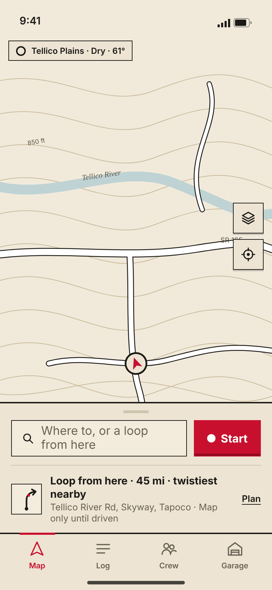

### Plan: the basic sheet

[`02-plan-basic.html`](02-plan-basic.html)

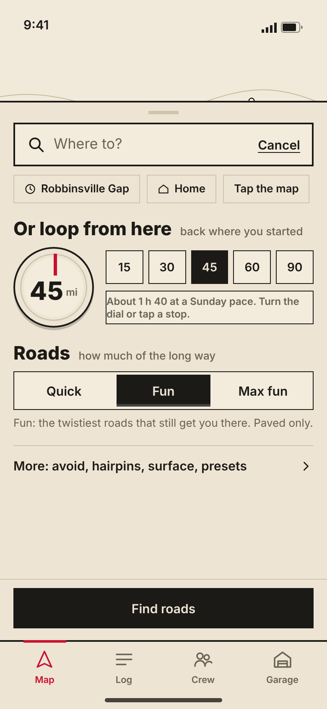

### Plan: more options (power user)

[`03-plan-more.html`](03-plan-more.html)

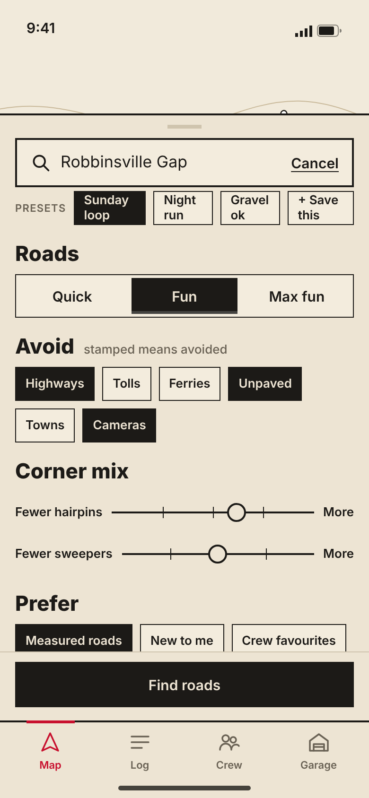

### Route card

[`04-route-card.html`](04-route-card.html)

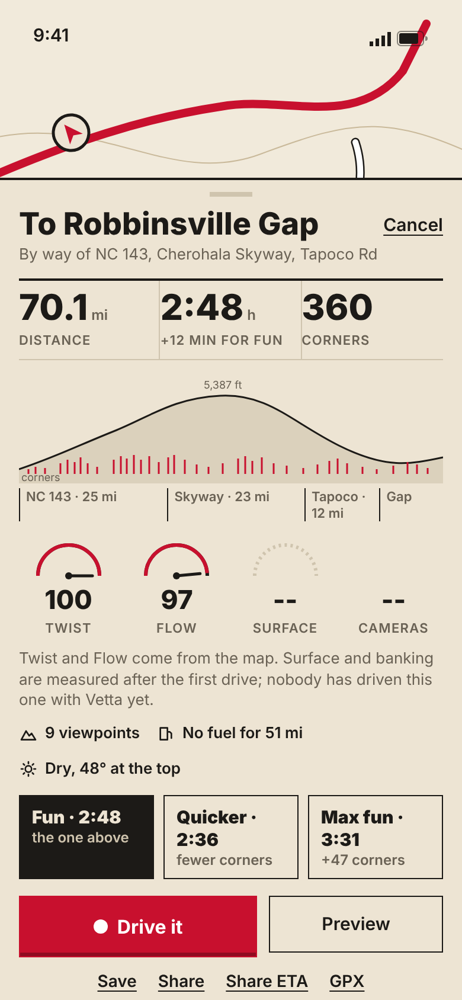

### Driving, Roadbook day

[`05-drive-roadbook.html`](05-drive-roadbook.html)

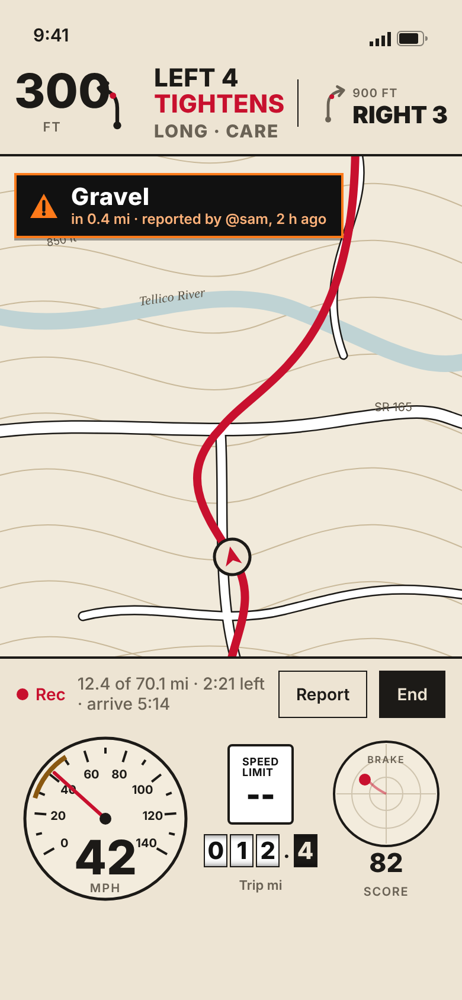

### Driving, Roadbook night

[`06-drive-roadbook-night.html`](06-drive-roadbook-night.html)

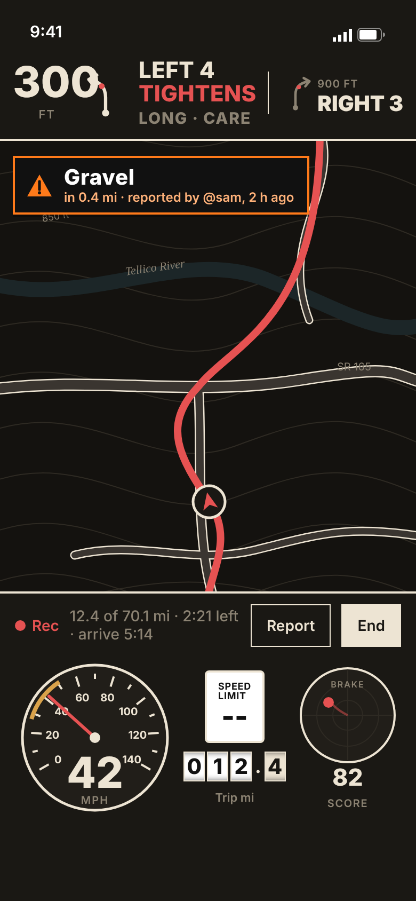

### Driving, Tapedeck (Pro)

[`07-drive-tapedeck.html`](07-drive-tapedeck.html)

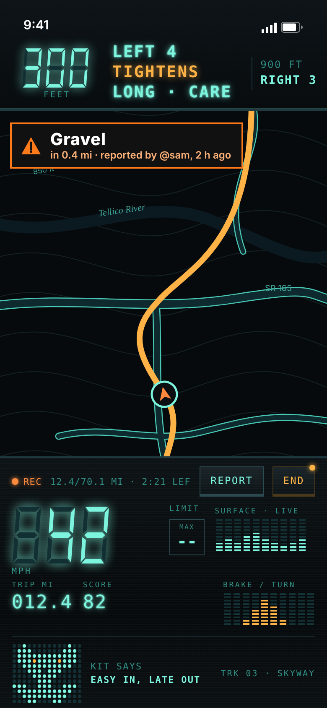

### Driving, Billet (Pro)

[`08-drive-billet.html`](08-drive-billet.html)

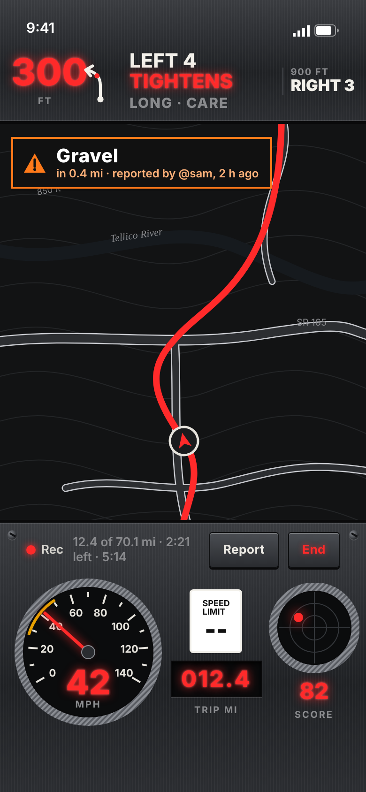

### Crew page with livery

[`09-crew-page.html`](09-crew-page.html)

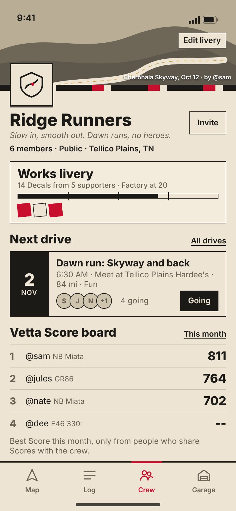

### Build thread

[`10-build-thread.html`](10-build-thread.html)

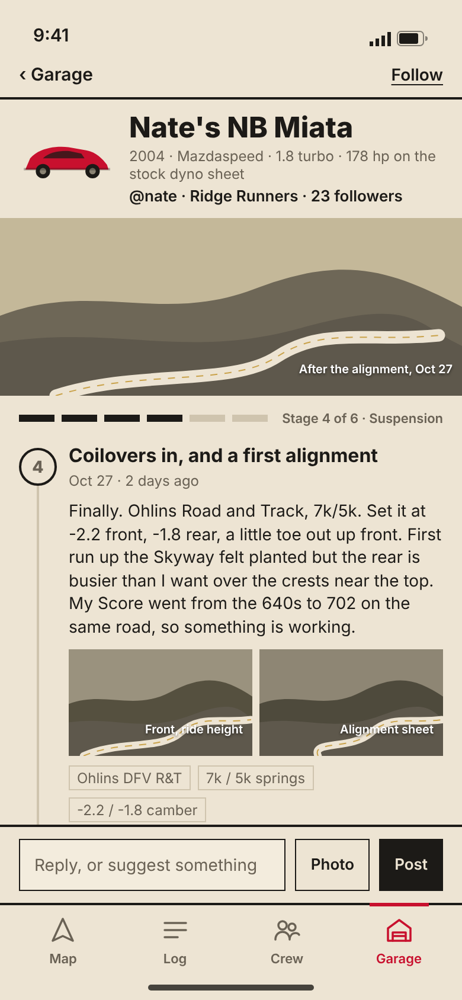

### Theme picker (Look and voice)

[`11-theme-picker.html`](11-theme-picker.html)

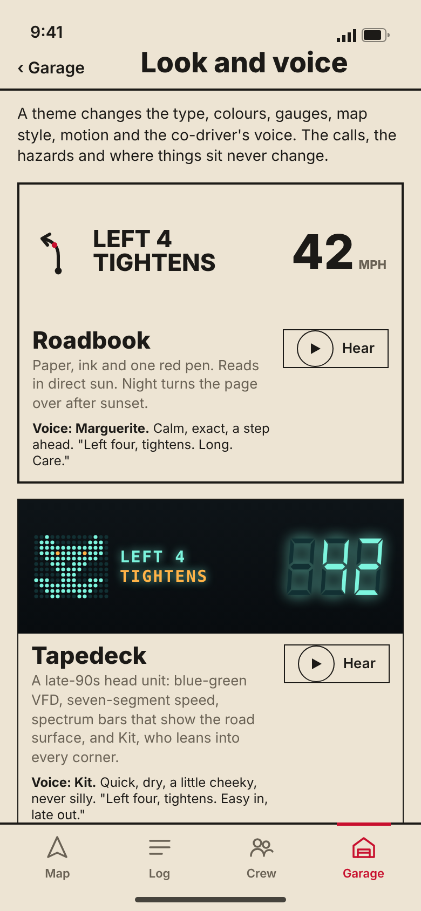

### Friends on the map

[`12-friends-map.html`](12-friends-map.html)

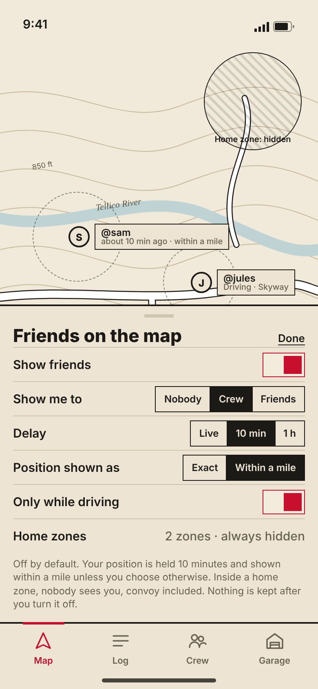
